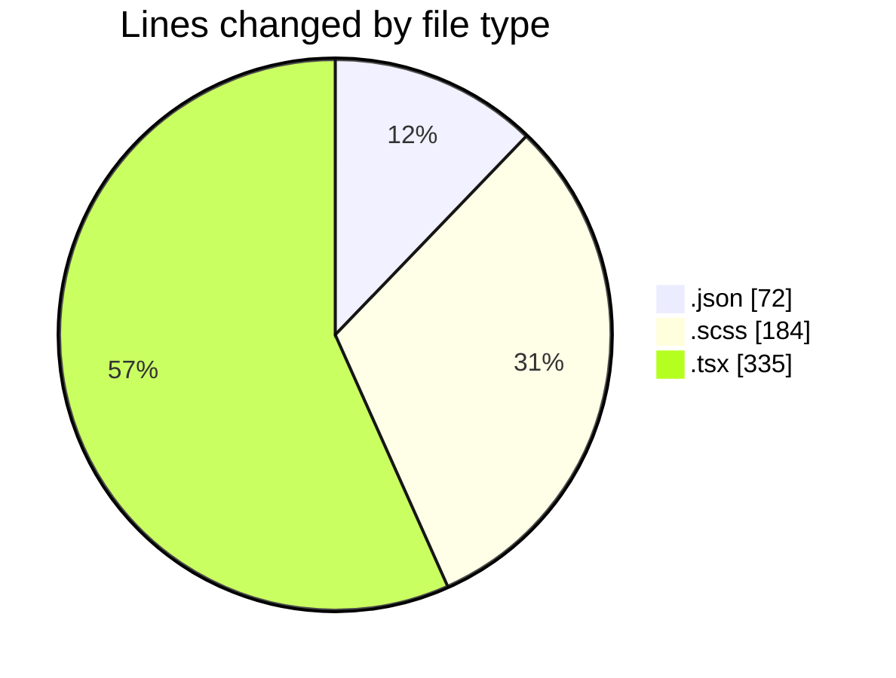
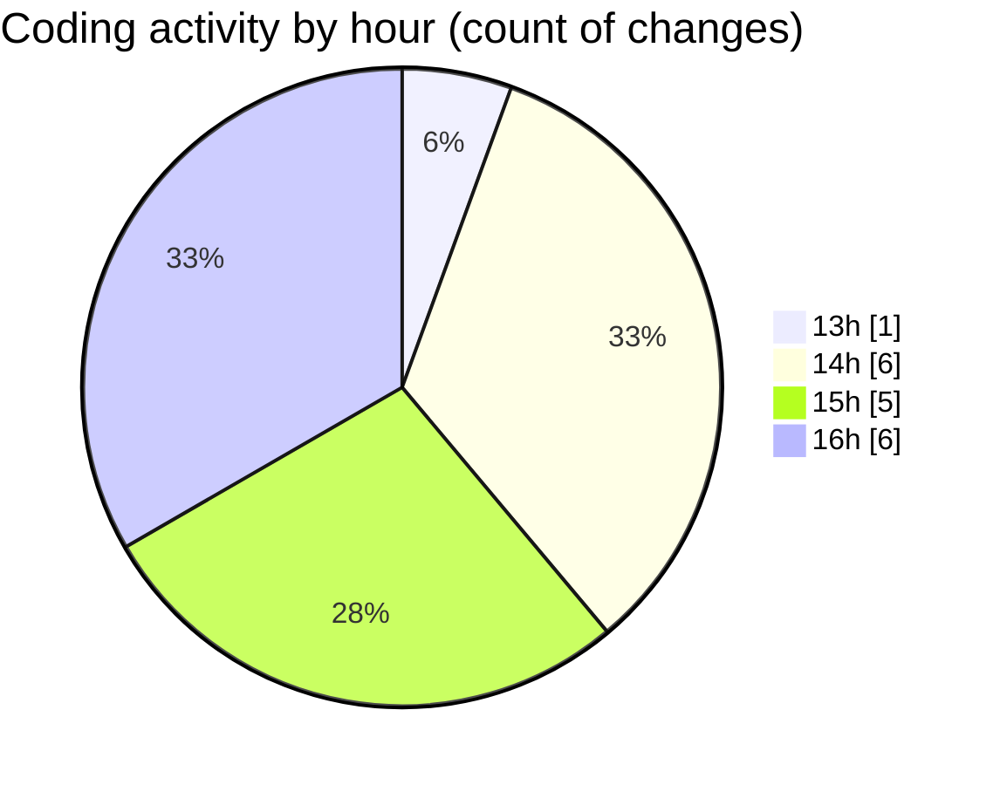

# cda - Activity Summary 

## Overall Statistics

| Stat                   | Value                                                             |
| ---------------------- | ----------------------------------------------------------------- |
| **Lines Added** (➕)   | 577                                          |
| **Lines Removed** (➖) | 14                                        |
| **Net Change** (↕)    | 563                |
| **Active Time** (⌚)   | 15 minutes |

## Modified Files
- **package.json** (+72, -0)
- **Alerts.scss** (+101, -5)
- **Cohorts.tsx** (+156, -0)
- **index.scss** (+8, -0)
- **Cohorts.test.tsx** (+176, -3)
- **Group.scss** (+64, -6)

## Visualizations

### By File Type (Lines Changed)

### By Hour (Estimated Activity Count)

> **Last Updated:** 12/10/2026, 16:39:11