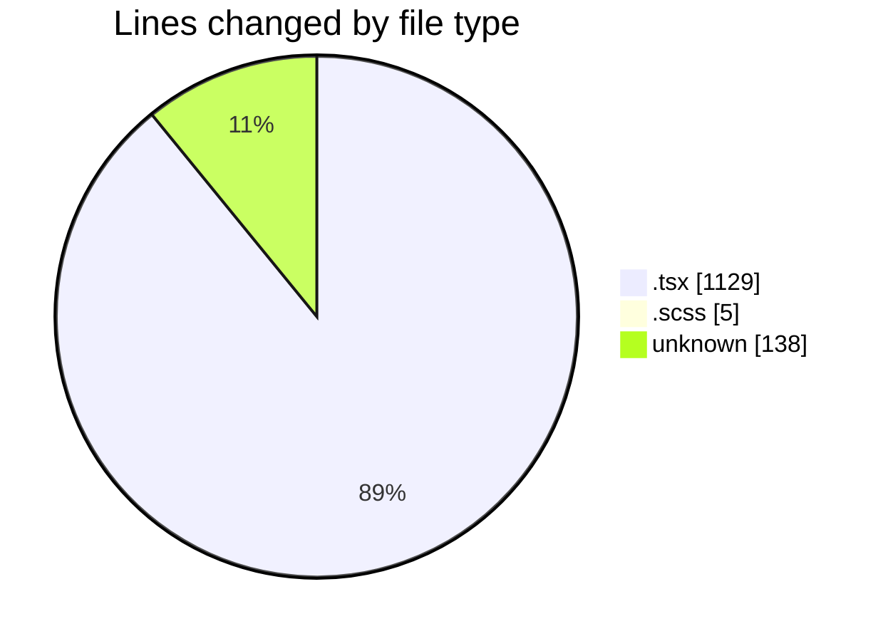
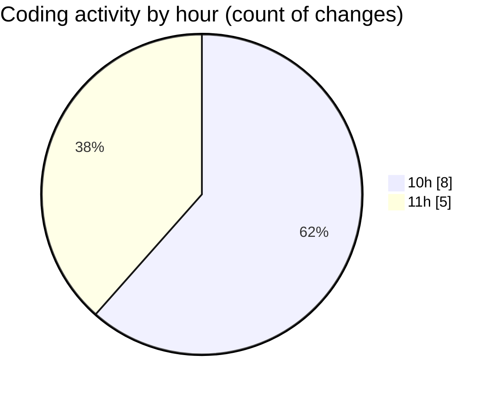

# cda - Activity Summary 

## Overall Statistics

| Stat                   | Value                                                             |
| ---------------------- | ----------------------------------------------------------------- |
| **Lines Added** (➕)   | 1131                                          |
| **Lines Removed** (➖) | 141                                        |
| **Net Change** (↕)    | 990                |
| **Active Time** (⌚)   | 14 minutes |

## Modified Files
- **AggregatedRequestsTable.tsx** (+170, -0)
- **StackedBarChart.tsx** (+175, -0)
- **Group.scss** (+0, -5)
- **DeduplicatedSiteRequestsTable.tsx** (+163, -0)
- **RequestsBySite.tsx** (+0, -1)
- **RequestsDotsChart.tsx** (+0, -78)
- **RequestsDotsChart.test.tsx** (+0, -51)
- **.env** (+138, -0)
- **Cohorts.test.tsx** (+183, -0)
- **Cohorts.tsx** (+156, -0)
- **CohortDetail.tsx** (+146, -6)

## Visualizations

### By File Type (Lines Changed)

### By Hour (Estimated Activity Count)

> **Last Updated:** 13/10/2026, 11:09:11