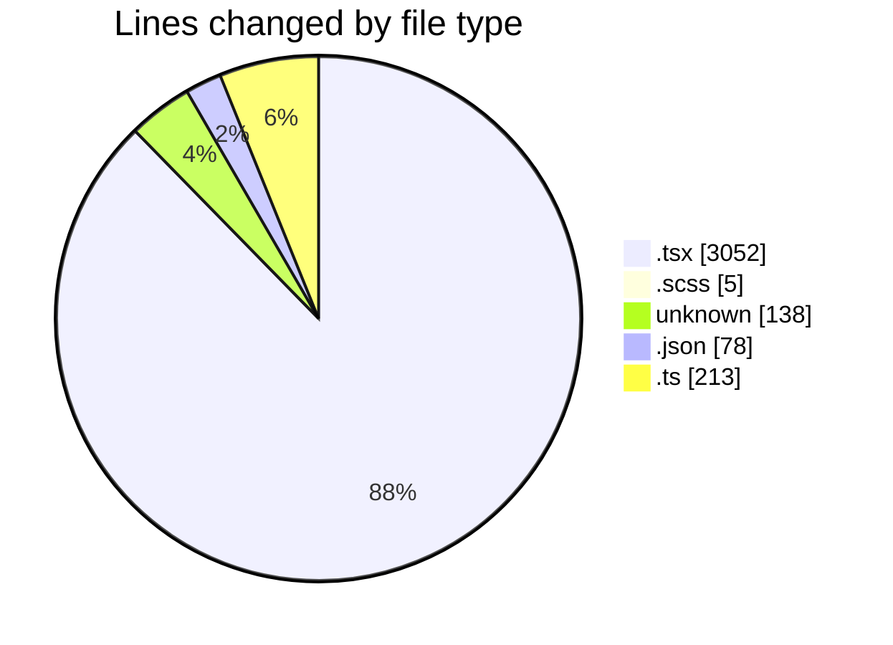
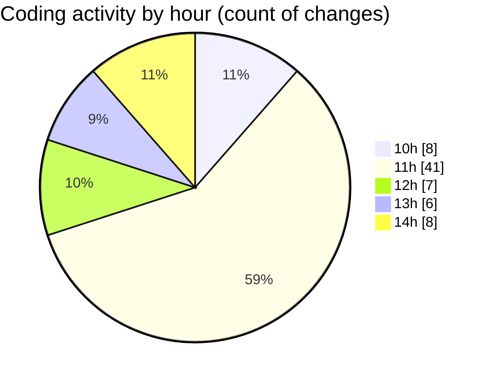

# cda - Activity Summary 

## Overall Statistics

| Stat                   | Value                                                             |
| ---------------------- | ----------------------------------------------------------------- |
| **Lines Added** (➕)   | 3090                                          |
| **Lines Removed** (➖) | 396                                        |
| **Net Change** (↕)    | 2694                |
| **Active Time** (⌚)   | 96 minutes |

## Modified Files
- **AggregatedRequestsTable.tsx** (+170, -0)
- **StackedBarChart.tsx** (+229, -10)
- **Group.scss** (+0, -5)
- **DeduplicatedSiteRequestsTable.tsx** (+163, -0)
- **RequestsBySite.tsx** (+0, -1)
- **RequestsDotsChart.tsx** (+78, -78)
- **RequestsDotsChart.test.tsx** (+68, -51)
- **.env** (+138, -0)
- **Cohorts.test.tsx** (+284, -72)
- **Cohorts.tsx** (+201, -27)
- **CohortDetail.tsx** (+174, -67)
- **AlertedStaffTable.tsx** (+131, -0)
- **GroupMembersTable.tsx** (+276, -0)
- **GroupAdminsTable.tsx** (+216, -0)
- **CohortMembers.tsx** (+352, -0)
- **CohortDetail.test.tsx** (+242, -78)
- **package.json** (+78, -0)
- **date.test.ts** (+127, -0)
- **date.ts** (+86, -0)
- **CohortAccessMarker.tsx** (+39, -7)
- **CohortAccessMarker.test.tsx** (+38, -0)

## Visualizations

### By File Type (Lines Changed)

### By Hour (Estimated Activity Count)

> **Last Updated:** 13/10/2026, 14:34:11