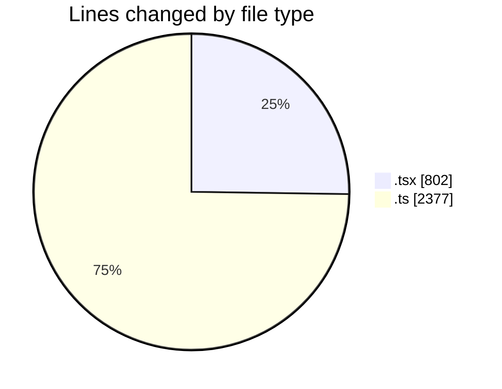
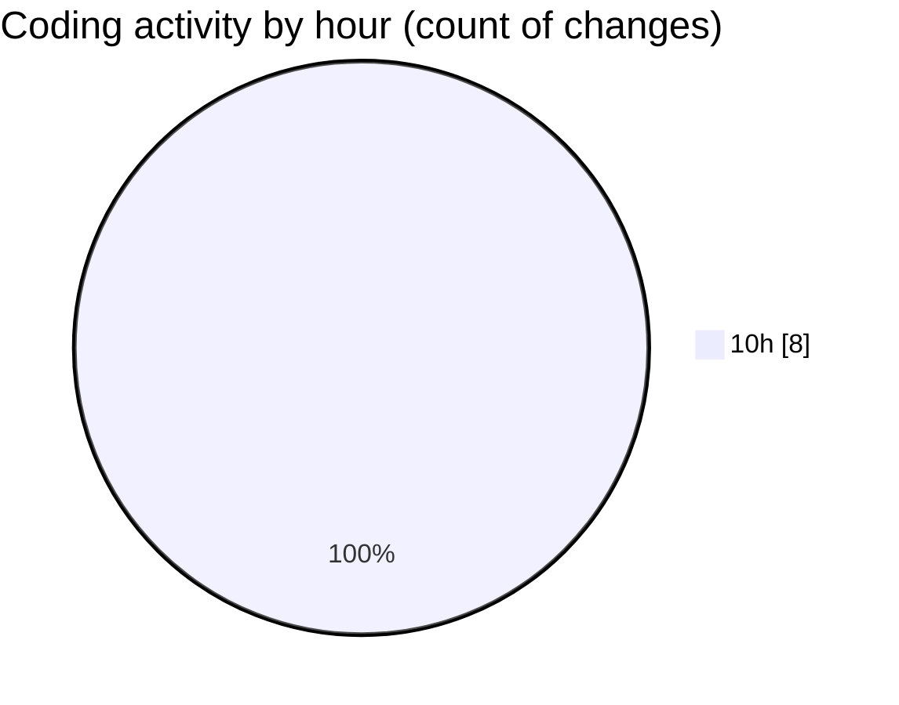

# cda - Activity Summary 

## Overall Statistics

| Stat                   | Value                                                             |
| ---------------------- | ----------------------------------------------------------------- |
| **Lines Added** (➕)   | 3179                                          |
| **Lines Removed** (➖) | 0                                        |
| **Net Change** (↕)    | 3179                |
| **Active Time** (⌚)   | 5 minutes |

## Modified Files
- **CohortTemplates.tsx** (+315, -0)
- **NewTemplate.tsx** (+313, -0)
- **CohortService.ts** (+320, -0)
- **PermissionService.ts** (+884, -0)
- **TemplateService.ts** (+263, -0)
- **MockPermissionsService.ts** (+233, -0)
- **CohortService.test.ts** (+677, -0)
- **Cohorts.tsx** (+174, -0)

## Visualizations

### By File Type (Lines Changed)

### By Hour (Estimated Activity Count)

> **Last Updated:** 14/10/2026, 10:52:36