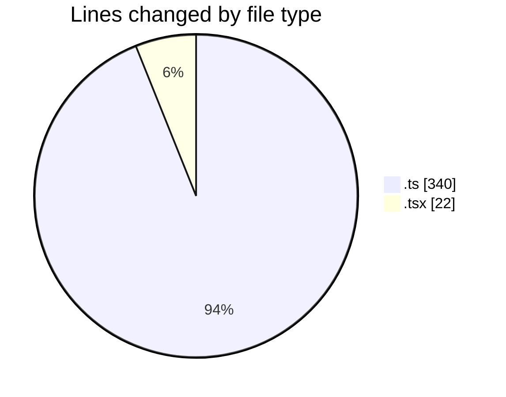
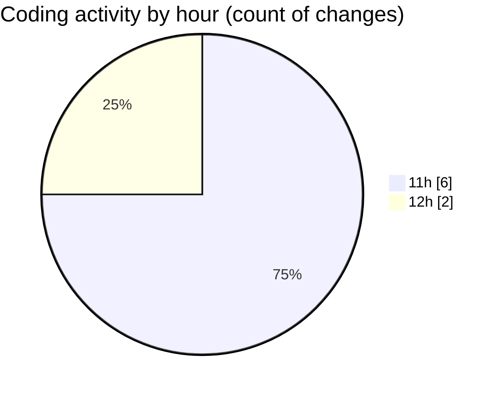

# cda - Activity Summary 

## Overall Statistics

| Stat                   | Value                                                             |
| ---------------------- | ----------------------------------------------------------------- |
| **Lines Added** (➕)   | 195                                          |
| **Lines Removed** (➖) | 167                                        |
| **Net Change** (↕)    | 28                |
| **Active Time** (⌚)   | 5 minutes |

## Modified Files
- **TemplateService.test.ts** (+108, -102)
- **PermissionService.test.ts** (+65, -65)
- **NewTemplate.tsx** (+21, -0)
- **Cohorts.tsx** (+1, -0)

## Visualizations

### By File Type (Lines Changed)

### By Hour (Estimated Activity Count)

> **Last Updated:** 15/10/2026, 12:07:37