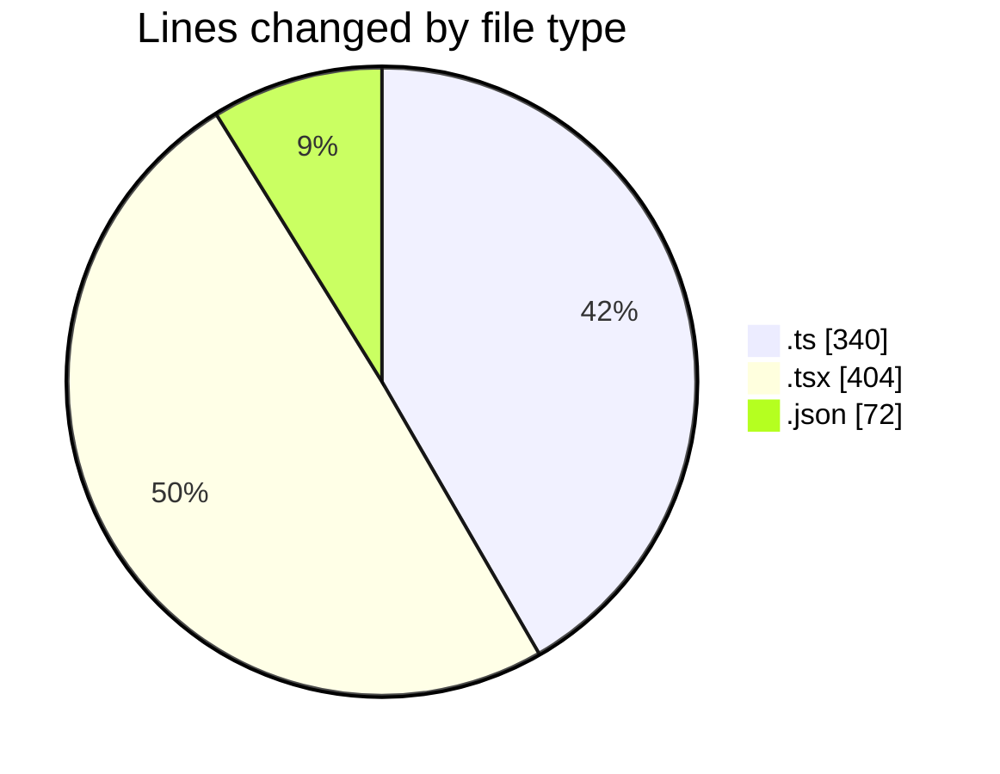
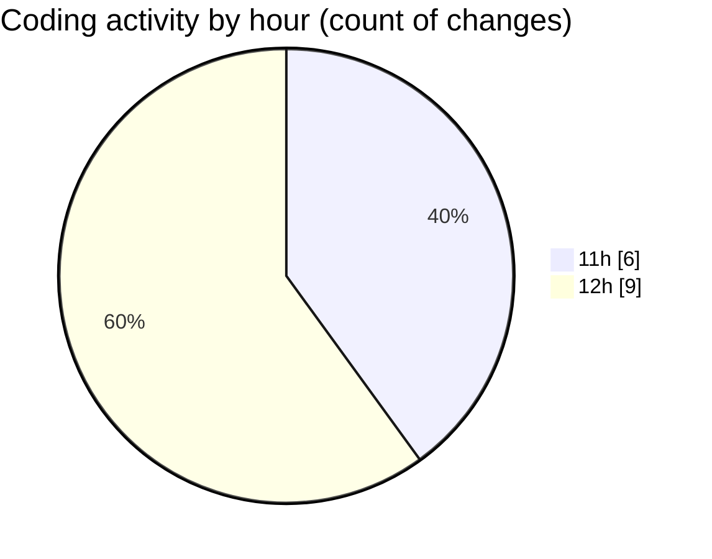

# cda - Activity Summary 

## Overall Statistics

| Stat                   | Value                                                             |
| ---------------------- | ----------------------------------------------------------------- |
| **Lines Added** (➕)   | 644                                          |
| **Lines Removed** (➖) | 172                                        |
| **Net Change** (↕)    | 472                |
| **Active Time** (⌚)   | 16 minutes |

## Modified Files
- **TemplateService.test.ts** (+108, -102)
- **PermissionService.test.ts** (+65, -65)
- **NewTemplate.tsx** (+25, -4)
- **Cohorts.tsx** (+1, -1)
- **NewTemplate.test.tsx** (+373, -0)
- **package.json** (+72, -0)

## Visualizations

### By File Type (Lines Changed)

### By Hour (Estimated Activity Count)

> **Last Updated:** 15/10/2026, 12:22:37