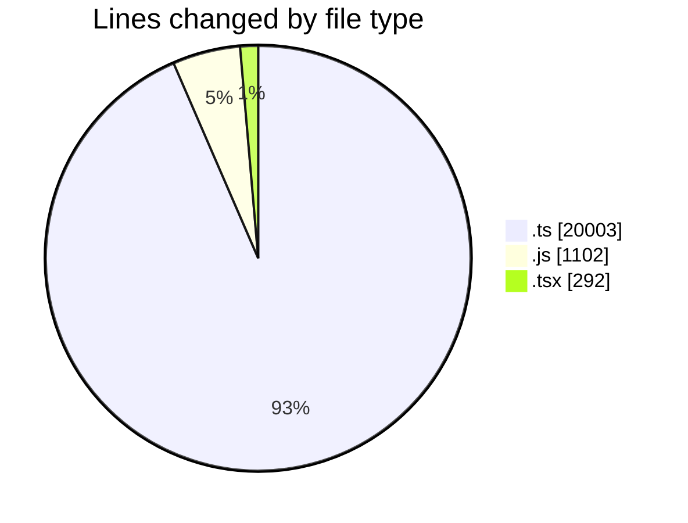
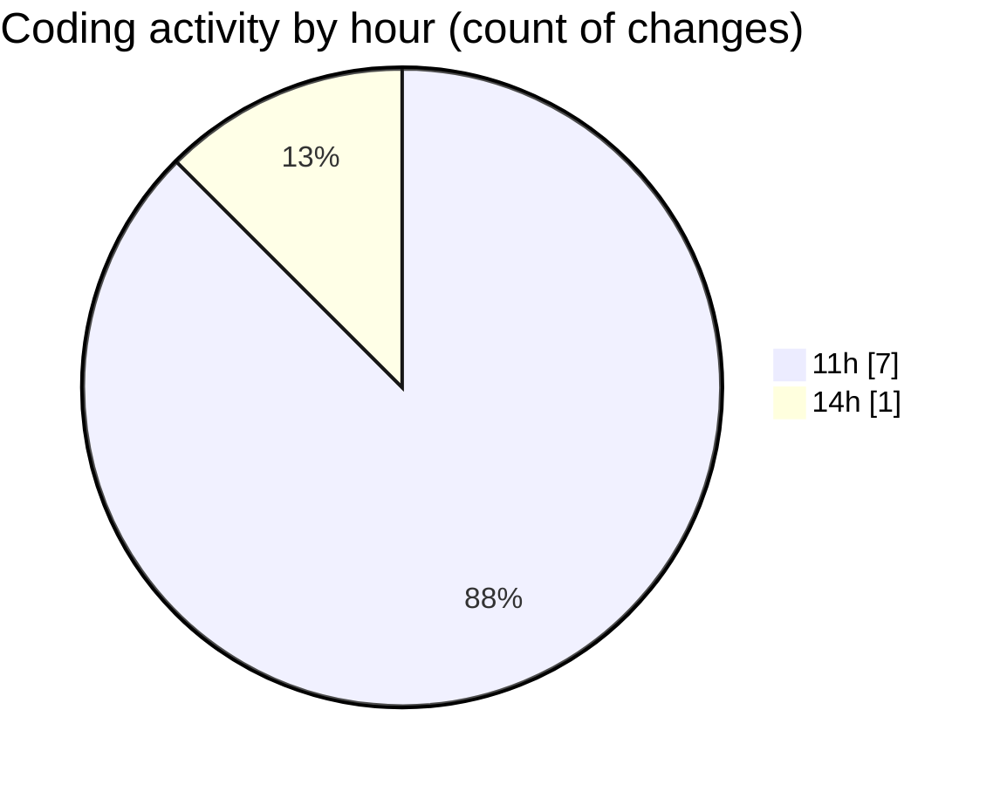

# cda - Activity Summary 

## Overall Statistics

| Stat                   | Value                                                             |
| ---------------------- | ----------------------------------------------------------------- |
| **Lines Added** (➕)   | 21397                                          |
| **Lines Removed** (➖) | 0                                        |
| **Net Change** (↕)    | 21397                |
| **Active Time** (⌚)   | 0 minute |

## Modified Files
- **GroupMemberService.ts** (+327, -0)
- **yesalert.js** (+1102, -0)
- **resolvers-types.ts** (+18000, -0)
- **ReportingService.ts** (+301, -0)
- **GroupMemberService.test.ts** (+557, -0)
- **group-member-queries.ts** (+363, -0)
- **ReportingService.test.ts** (+455, -0)
- **Home.tsx** (+292, -0)

## Visualizations

### By File Type (Lines Changed)

### By Hour (Estimated Activity Count)

> **Last Updated:** 16/10/2026, 14:38:37