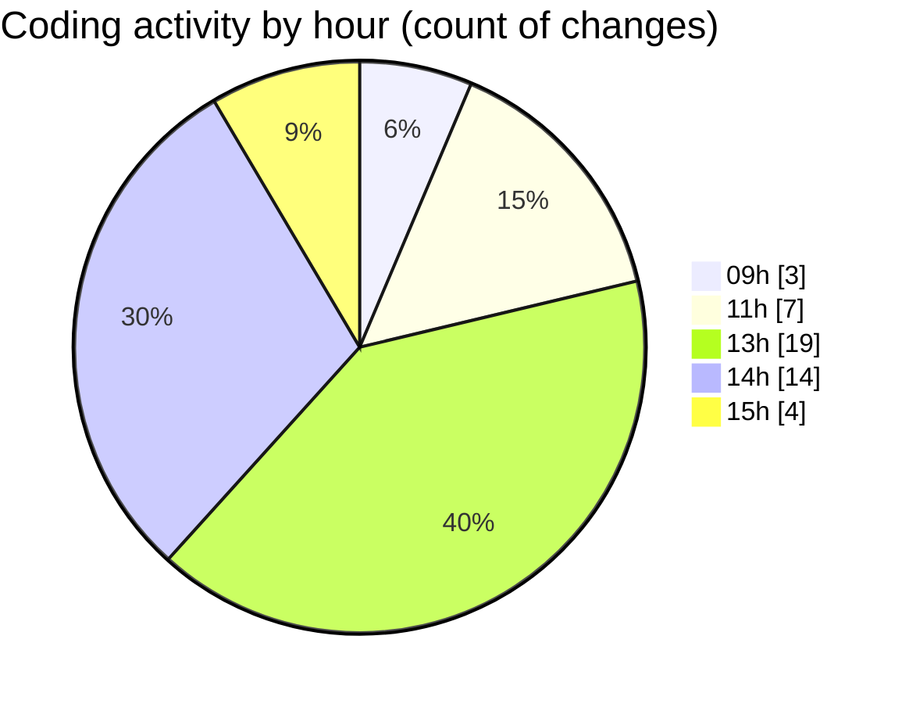

# cda - Activity Summary 

## Overall Statistics

| Stat                   | Value                                                             |
| ---------------------- | ----------------------------------------------------------------- |
| **Lines Added** (➕)   | 27514                                          |
| **Lines Removed** (➖) | 511                                        |
| **Net Change** (↕)    | 27003                |
| **Active Time** (⌚)   | 56 minutes |

## Modified Files
- **Home.test.tsx** (+710, -207)
- **RequestsDotsChart.tsx** (+332, -0)
- **RequestsDotsChart.test.tsx** (+172, -38)
- **package.json** (+78, -0)
- **yesalert.js** (+1092, -13)
- **TemplateService.test.ts** (+1057, -145)
- **template-queries.ts** (+544, -13)
- **TemplateService.ts** (+455, -95)
- **PoolPositionService.test.ts** (+4003, -0)
- **resolvers-types.ts** (+17893, -0)
- **AuditService.ts** (+397, -0)
- **MockTemplateService.ts** (+82, -0)
- **CohortService.test.ts** (+699, -0)

## Visualizations

### By File Type (Lines Changed)

### By Hour (Estimated Activity Count)

> **Last Updated:** 19/10/2026, 15:03:49