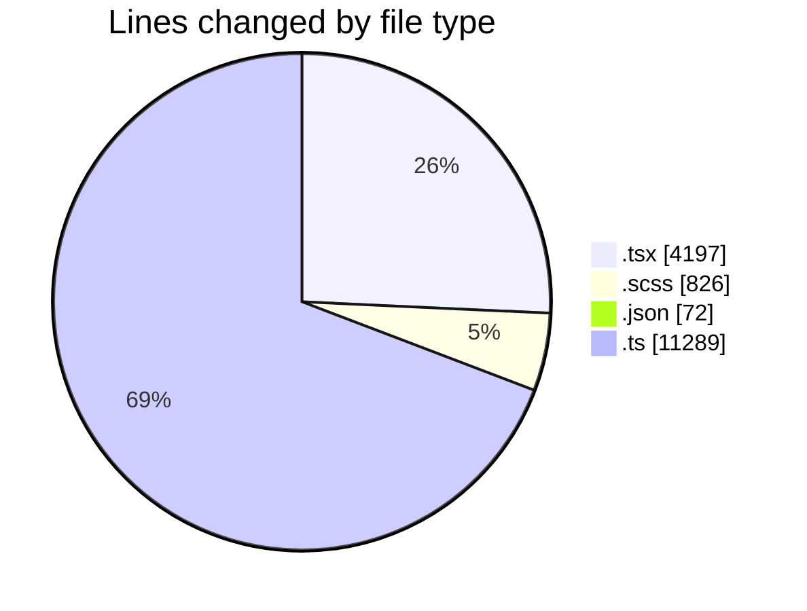
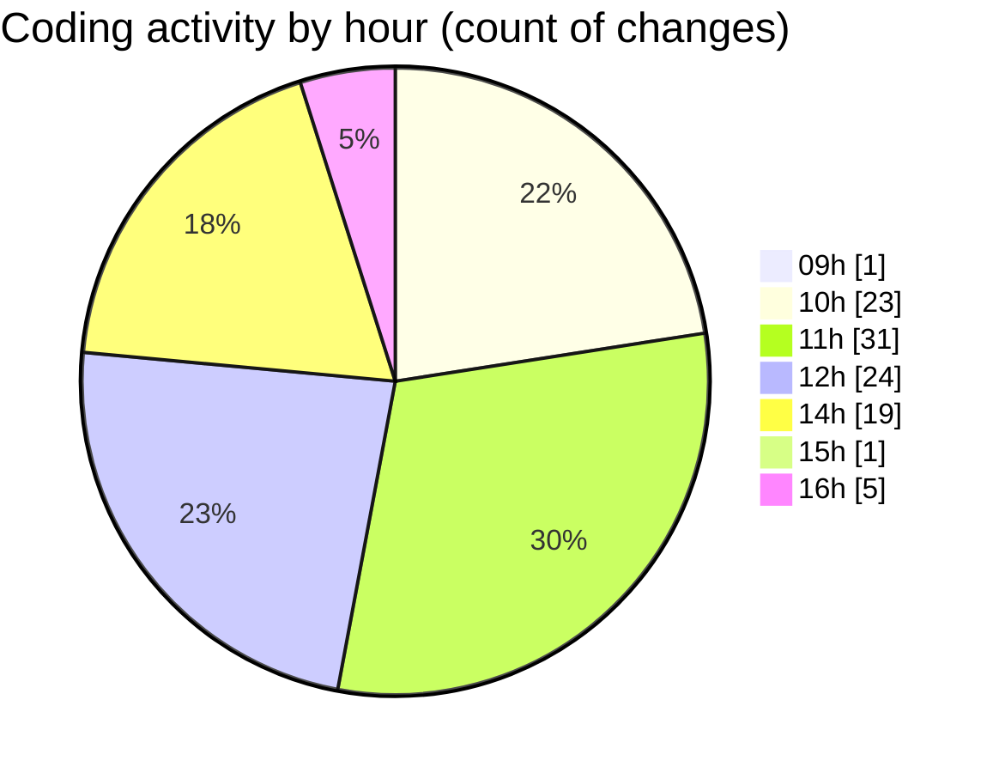

# cda - Activity Summary 

## Overall Statistics

| Stat                   | Value                                                             |
| ---------------------- | ----------------------------------------------------------------- |
| **Lines Added** (➕)   | 15871                                          |
| **Lines Removed** (➖) | 513                                        |
| **Net Change** (↕)    | 15358                |
| **Active Time** (⌚)   | 126 minutes |

## Modified Files
- **CohortTemplates.tsx** (+302, -54)
- **Templates.tsx** (+555, -9)
- **RequestsDotsChart.tsx** (+544, -212)
- **RequestsDotsChart.test.tsx** (+232, -0)
- **RequestsDotsChart.scss** (+31, -2)
- **CohortTemplates.test.tsx** (+238, -0)
- **TemplateDetail.tsx** (+317, -11)
- **TemplateDetail.scss** (+40, -8)
- **FormattedTimestamp.scss** (+98, -3)
- **NewTemplate.tsx** (+341, -2)
- **AlertForm.tsx** (+363, -0)
- **AlertForm.scss** (+166, -0)
- **TemplateDetail.test.tsx** (+432, -27)
- **NewTemplate.test.tsx** (+411, -0)
- **NewTemplate.scss** (+32, -0)
- **Templates.scss** (+261, -185)
- **package.json** (+72, -0)
- **AccessMarker.tsx** (+51, -0)
- **AccessMarker.test.tsx** (+96, -0)
- **gql.ts** (+478, -0)
- **graphql.ts** (+10757, -0)
- **templates.ts** (+54, -0)

## Visualizations

### By File Type (Lines Changed)

### By Hour (Estimated Activity Count)

> **Last Updated:** 20/10/2026, 16:44:29