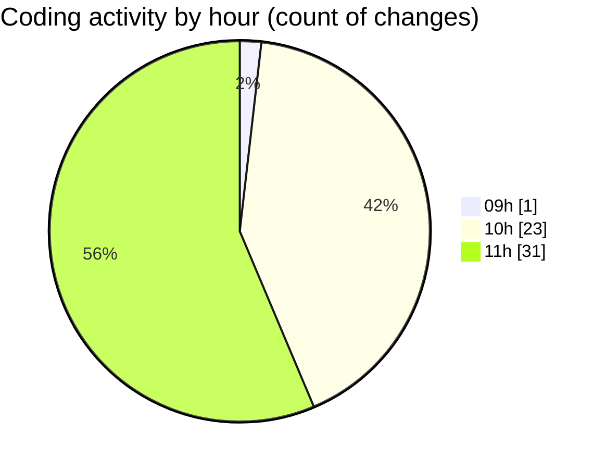

# cda - Activity Summary 

## Overall Statistics

| Stat                   | Value                                                             |
| ---------------------- | ----------------------------------------------------------------- |
| **Lines Added** (➕)   | 1972                                          |
| **Lines Removed** (➖) | 279                                        |
| **Net Change** (↕)    | 1693                |
| **Active Time** (⌚)   | 69 minutes |

## Modified Files
- **CohortTemplates.tsx** (+248, -54)
- **Templates.tsx** (+255, -0)
- **RequestsDotsChart.tsx** (+544, -212)
- **RequestsDotsChart.test.tsx** (+232, -0)
- **RequestsDotsChart.scss** (+31, -2)
- **CohortTemplates.test.tsx** (+238, -0)
- **TemplateDetail.tsx** (+313, -5)
- **TemplateDetail.scss** (+14, -4)
- **FormattedTimestamp.scss** (+97, -2)

## Visualizations

### By File Type (Lines Changed)

### By Hour (Estimated Activity Count)

> **Last Updated:** 20/10/2026, 11:58:57