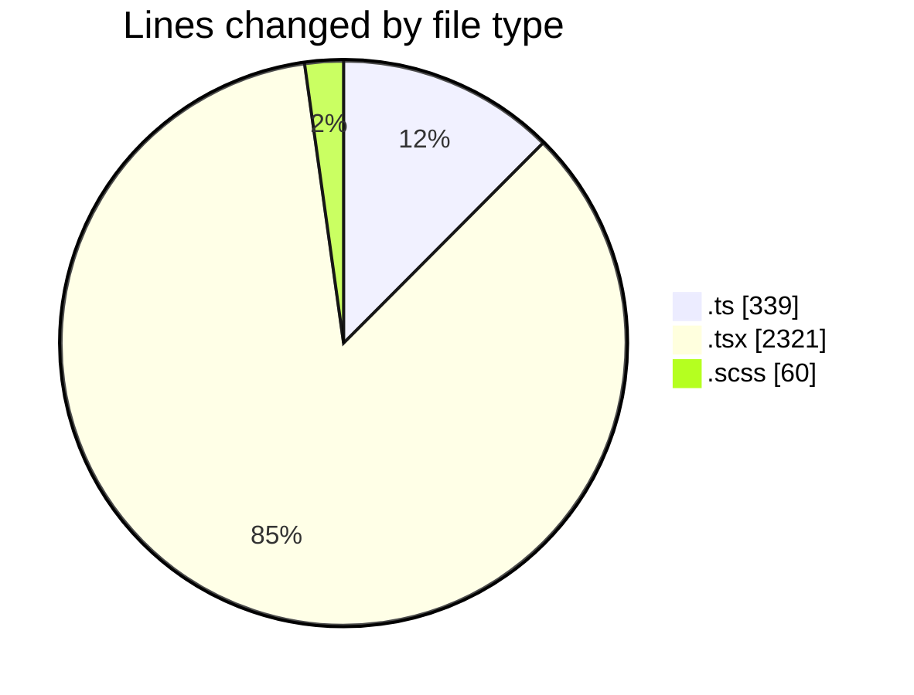
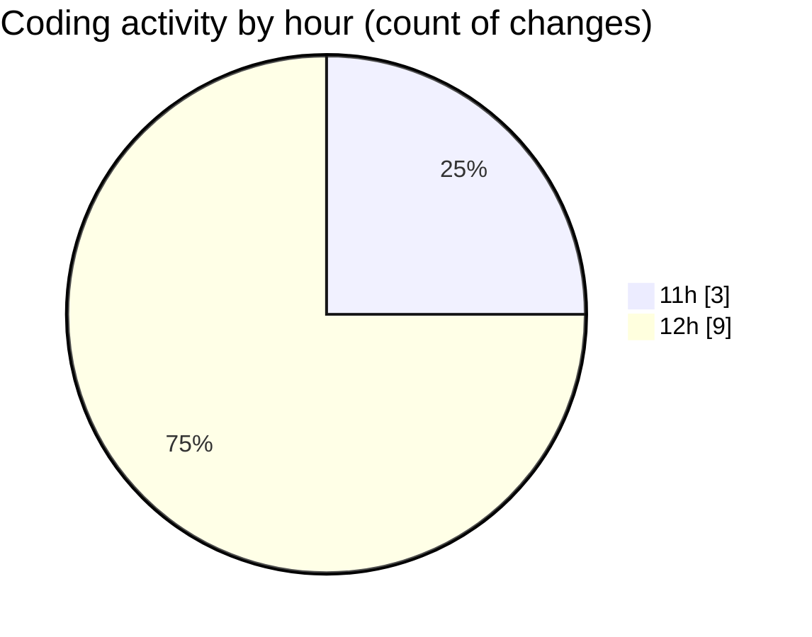

# cda - Activity Summary 

## Overall Statistics

| Stat                   | Value                                                             |
| ---------------------- | ----------------------------------------------------------------- |
| **Lines Added** (➕)   | 2715                                          |
| **Lines Removed** (➖) | 5                                        |
| **Net Change** (↕)    | 2710                |
| **Active Time** (⌚)   | 12 minutes |

## Modified Files
- **GroupMemberService.ts** (+335, -4)
- **Incidents.tsx** (+636, -0)
- **Incidents.test.tsx** (+610, -0)
- **FaultsTable.tsx** (+287, -0)
- **FaultsTable.test.tsx** (+224, -0)
- **FaultsTable.scss** (+60, -0)
- **SiteAllIncidents.tsx** (+265, -1)
- **SiteAllIncidents.test.tsx** (+298, -0)

## Visualizations

### By File Type (Lines Changed)

### By Hour (Estimated Activity Count)

> **Last Updated:** 21/10/2026, 12:45:12