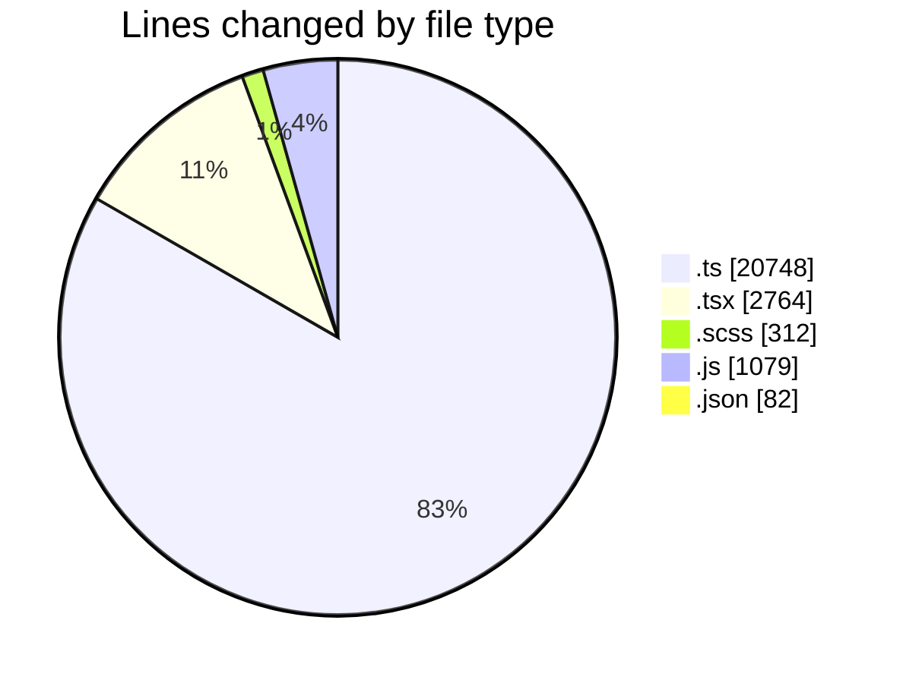
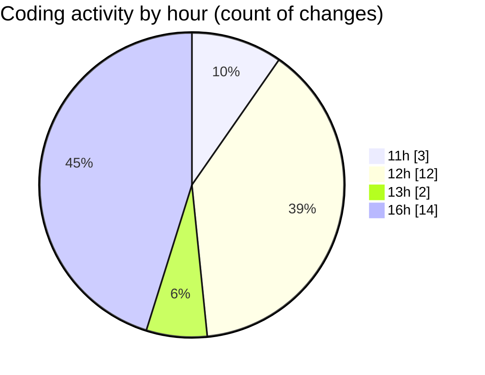

# cda - Activity Summary 

## Overall Statistics

| Stat                   | Value                                                             |
| ---------------------- | ----------------------------------------------------------------- |
| **Lines Added** (➕)   | 24823                                          |
| **Lines Removed** (➖) | 162                                        |
| **Net Change** (↕)    | 24661                |
| **Active Time** (⌚)   | 49 minutes |

## Modified Files
- **GroupMemberService.ts** (+335, -4)
- **Incidents.tsx** (+636, -0)
- **Incidents.test.tsx** (+610, -0)
- **FaultsTable.tsx** (+287, -0)
- **FaultsTable.test.tsx** (+224, -0)
- **FaultsTable.scss** (+60, -0)
- **SiteAllIncidents.tsx** (+265, -1)
- **SiteAllIncidents.test.tsx** (+298, -0)
- **CondensedFaultTable.scss** (+26, -0)
- **CondensedFaultTable.test.tsx** (+146, -0)
- **CondensedFaultTable.tsx** (+297, -0)
- **TemplateService.ts** (+743, -2)
- **TemplateService.test.ts** (+1219, -155)
- **yesalert.js** (+1079, -0)
- **AuditService.ts** (+397, -0)
- **resolvers-types.ts** (+17893, -0)
- **package.json** (+82, -0)
- **GroupMembers.scss** (+71, -0)
- **StatusBox.scss** (+155, -0)

## Visualizations

### By File Type (Lines Changed)

### By Hour (Estimated Activity Count)

> **Last Updated:** 21/10/2026, 16:51:06