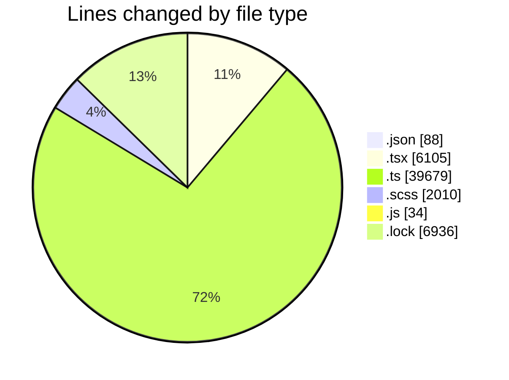
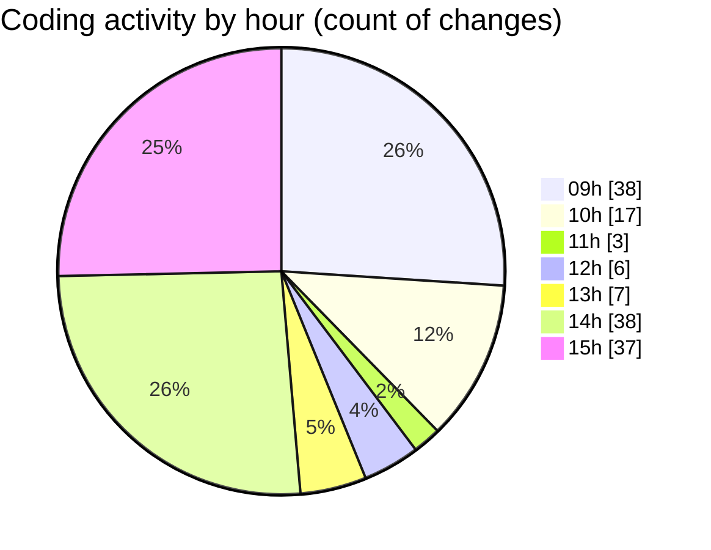

# cda - Activity Summary 

## Overall Statistics

| Stat                   | Value                                                             |
| ---------------------- | ----------------------------------------------------------------- |
| **Lines Added** (➕)   | 40336                                          |
| **Lines Removed** (➖) | 14516                                        |
| **Net Change** (↕)    | 25820                |
| **Active Time** (⌚)   | 165 minutes |

## Modified Files
- **package.json** (+39, -49)
- **GroupAdmins.tsx** (+444, -0)
- **TemplateService.ts** (+142, -167)
- **TemplateService.test.ts** (+334, -281)
- **AlertForm.test.tsx** (+616, -230)
- **gql.ts** (+750, -254)
- **AlertForm.tsx** (+397, -34)
- **AccessMarker.test.tsx** (+151, -54)
- **templates.ts** (+64, -10)
- **Templates.scss** (+799, -700)
- **Templates.test.tsx** (+584, -0)
- **index.scss** (+8, -0)
- **TemporaryEvent.test.tsx** (+233, -2)
- **App.scss** (+171, -0)
- **yesalert.js** (+30, -4)
- **AuditService.ts** (+9, -4)
- **resolvers-types.ts** (+12758, -12685)
- **MockTemplateService.ts** (+90, -8)
- **template-queries.ts** (+563, -32)
- **CohortService.test.ts** (+703, -2)
- **TemplateDetail.tsx** (+312, -0)
- **TemplateDetail.test.tsx** (+419, -0)
- **NewTemplate.scss** (+32, -0)
- **TemplateDetail.scss** (+32, -0)
- **NewTemplate.tsx** (+339, -0)
- **CohortTemplates.tsx** (+248, -0)
- **CohortTemplates.test.tsx** (+286, -0)
- **FormattedTimestamp.scss** (+95, -0)
- **AccessMarker.tsx** (+51, -0)
- **graphql.ts** (+10823, -0)
- **Templates.tsx** (+330, -0)
- **yarn.lock** (+6936, -0)
- **IncidentReports.test.tsx** (+342, -0)
- **CommonTable.scss** (+123, -0)
- **IncidentReports.tsx** (+629, -0)
- **FaultsTable.scss** (+50, -0)
- **LocalDabFaultsTable.tsx** (+202, -0)
- **Incident.tsx** (+202, -0)

## Visualizations

### By File Type (Lines Changed)

### By Hour (Estimated Activity Count)

> **Last Updated:** 22/10/2026, 15:46:06