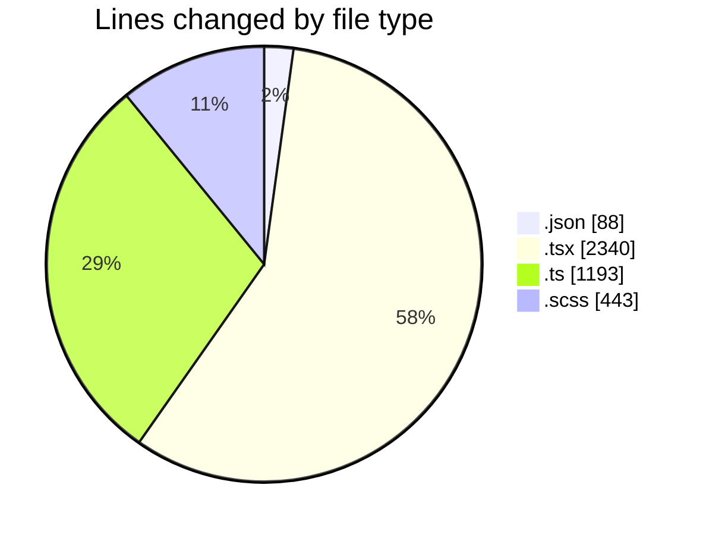
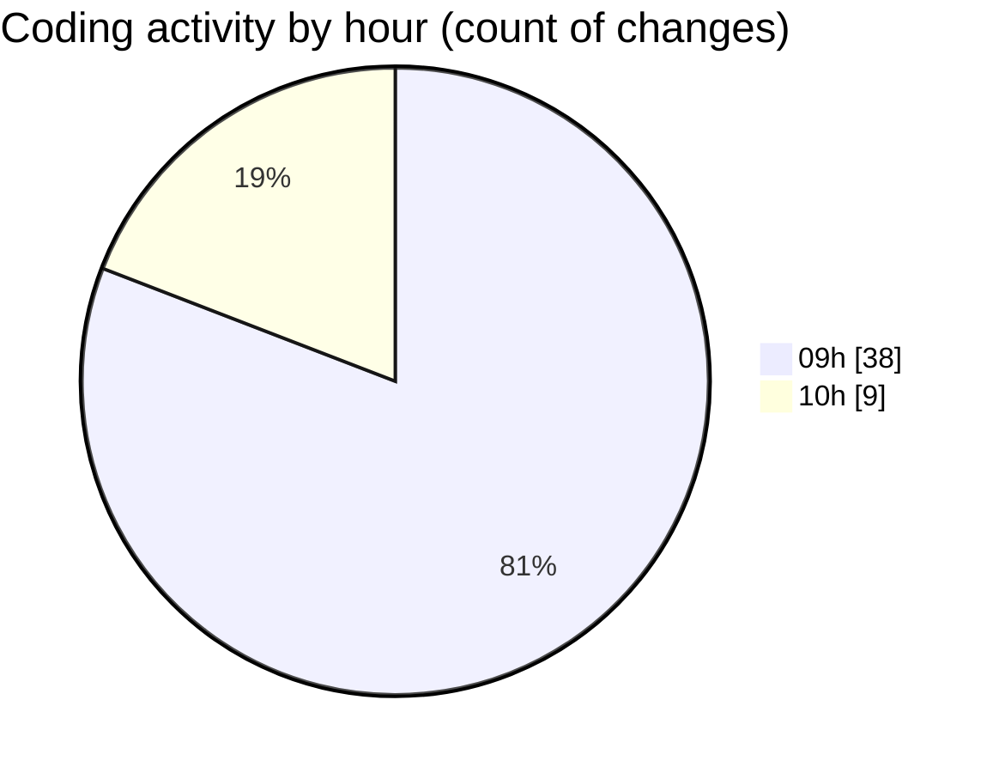

# cda - Activity Summary 

## Overall Statistics

| Stat                   | Value                                                             |
| ---------------------- | ----------------------------------------------------------------- |
| **Lines Added** (➕)   | 3273                                          |
| **Lines Removed** (➖) | 791                                        |
| **Net Change** (↕)    | 2482                |
| **Active Time** (⌚)   | 65 minutes |

## Modified Files
- **package.json** (+39, -49)
- **GroupAdmins.tsx** (+444, -0)
- **TemplateService.ts** (+30, -0)
- **TemplateService.test.ts** (+85, -0)
- **AlertForm.test.tsx** (+556, -180)
- **gql.ts** (+750, -254)
- **AlertForm.tsx** (+385, -24)
- **AccessMarker.test.tsx** (+113, -54)
- **templates.ts** (+64, -10)
- **Templates.scss** (+223, -220)
- **Templates.test.tsx** (+584, -0)

## Visualizations

### By File Type (Lines Changed)

### By Hour (Estimated Activity Count)

> **Last Updated:** 22/10/2026, 10:06:06