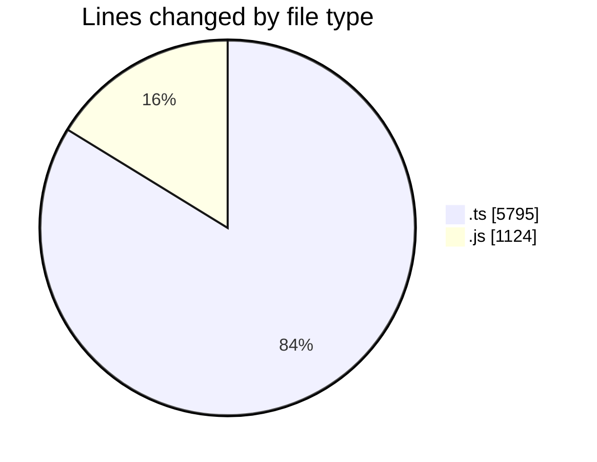
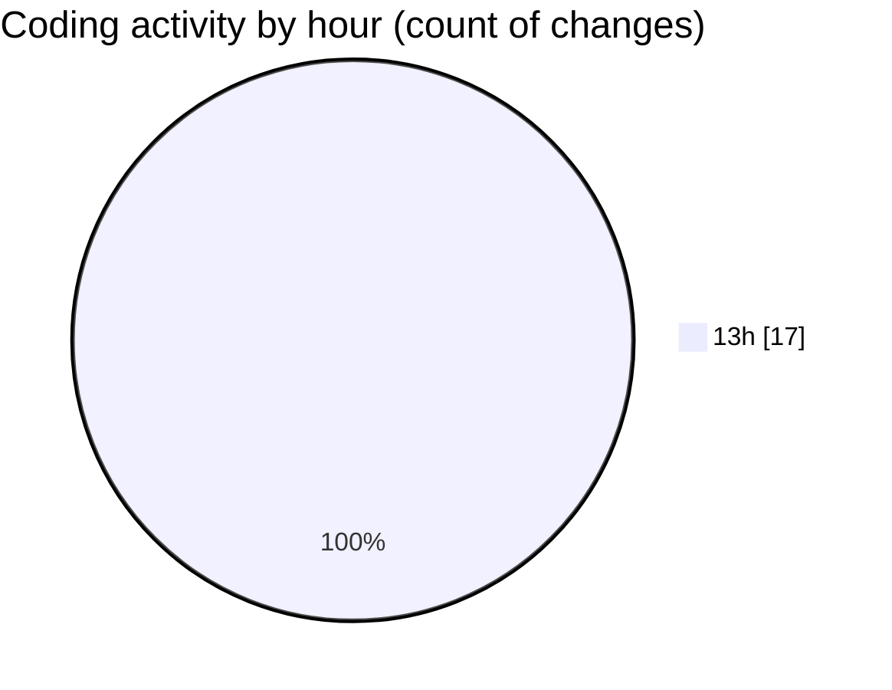

# cda - Activity Summary 

## Overall Statistics

| Stat                   | Value                                                             |
| ---------------------- | ----------------------------------------------------------------- |
| **Lines Added** (➕)   | 6911                                          |
| **Lines Removed** (➖) | 8                                        |
| **Net Change** (↕)    | 6903                |
| **Active Time** (⌚)   | 30 minutes |

## Modified Files
- **yesalert.ts** (+945, -0)
- **yesalert.js** (+1124, -0)
- **approvedUrl.ts** (+80, -0)
- **AlertService.ts** (+810, -8)
- **AuditService.ts** (+406, -0)
- **SystemService.ts** (+378, -0)
- **sap_views.ts** (+1887, -0)
- **TemplateService.test.ts** (+1067, -0)
- **YesAlertService.ts** (+214, -0)

## Visualizations

### By File Type (Lines Changed)

### By Hour (Estimated Activity Count)

> **Last Updated:** 23/10/2026, 13:56:54