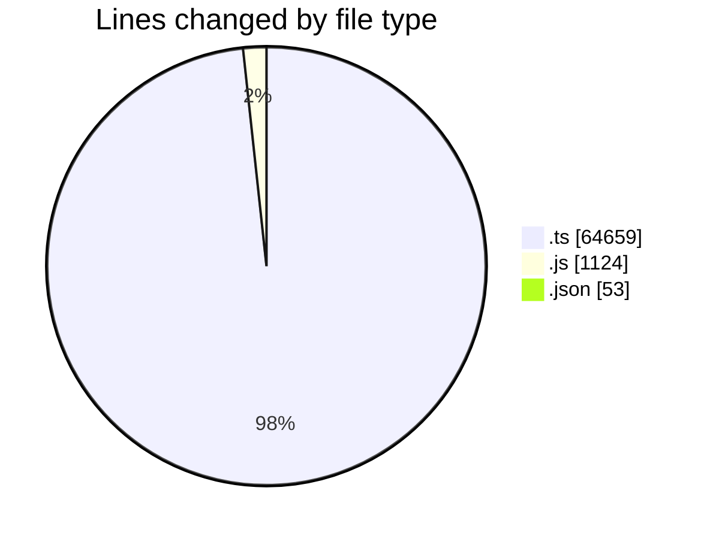
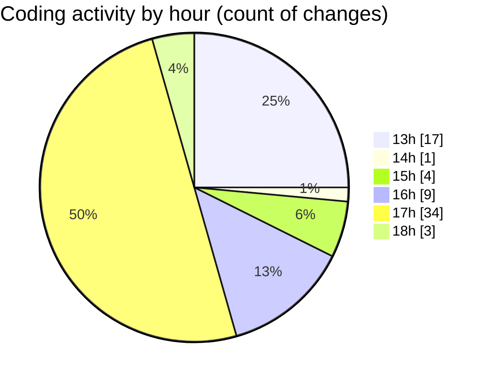

# cda - Activity Summary 

## Overall Statistics

| Stat                   | Value                                                             |
| ---------------------- | ----------------------------------------------------------------- |
| **Lines Added** (➕)   | 61164                                          |
| **Lines Removed** (➖) | 4672                                        |
| **Net Change** (↕)    | 56492                |
| **Active Time** (⌚)   | 91 minutes |

## Modified Files
- **yesalert.ts** (+945, -0)
- **yesalert.js** (+1124, -0)
- **approvedUrl.ts** (+88, -6)
- **AlertService.ts** (+823, -14)
- **AuditService.ts** (+406, -0)
- **SystemService.ts** (+385, -0)
- **sap_views.ts** (+1887, -0)
- **TemplateService.test.ts** (+1067, -3)
- **YesAlertService.ts** (+214, -0)
- **tables.ts** (+8298, -0)
- **resolvers-types.ts** (+22642, -4619)
- **sap_views.ts** (+1890, -0)
- **vulcan.ts** (+1724, -0)
- **views.ts** (+11417, -0)
- **PermissionService.ts** (+947, -0)
- **settings.json** (+53, -0)
- **alertTransformer.ts** (+82, -0)
- **policies.ts** (+28, -0)
- **MockPermissionsService.ts** (+241, -0)
- **yesalert-mutations.ts** (+1369, -0)
- **AlertService.test.ts** (+2021, -24)
- **ApprovedDomainSystemService.test.ts** (+181, -1)
- **PermissionService.test.ts** (+2936, -0)
- **approvedUrl.test.ts** (+81, -5)
- **alertTransformer.test.ts** (+26, -0)
- **MockStaffStatusService.ts** (+95, -0)
- **MockSystemService.ts** (+194, -0)

## Visualizations

### By File Type (Lines Changed)

### By Hour (Estimated Activity Count)

> **Last Updated:** 23/10/2026, 18:01:54