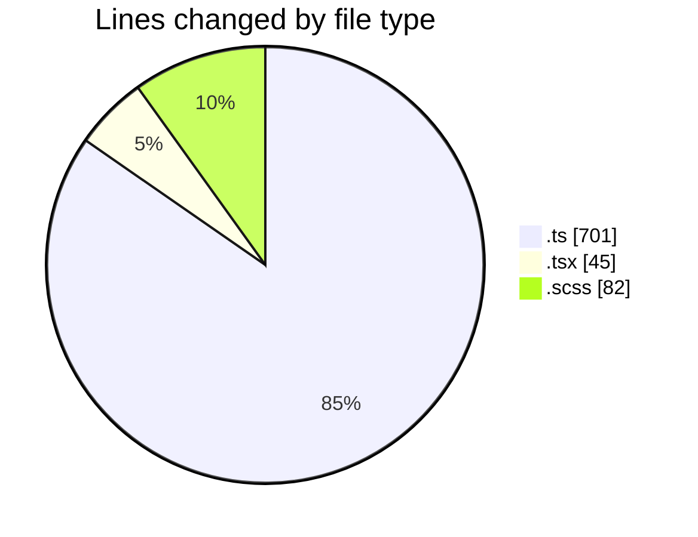
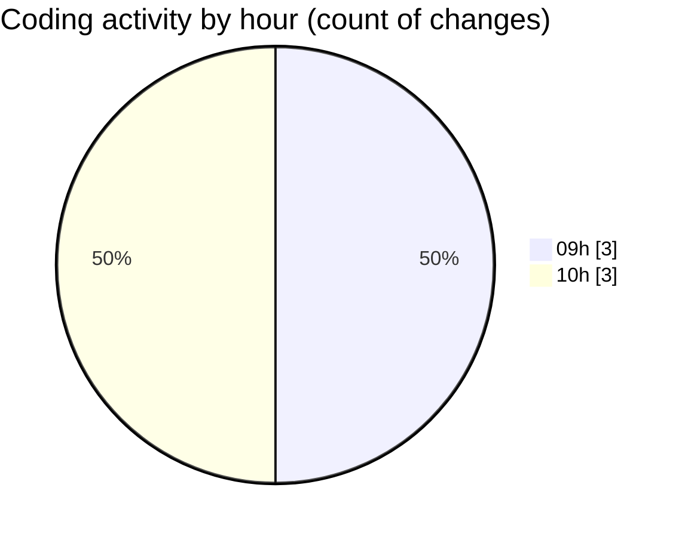

# cda - Activity Summary 

## Overall Statistics

| Stat                   | Value                                                             |
| ---------------------- | ----------------------------------------------------------------- |
| **Lines Added** (➕)   | 126                                          |
| **Lines Removed** (➖) | 702                                        |
| **Net Change** (↕)    | -576                |
| **Active Time** (⌚)   | 6 minutes |

## Modified Files
- **AlertService.ts** (+0, -75)
- **AlertService.test.ts** (+0, -508)
- **SystemService.ts** (+0, -118)
- **SkillTagCreateSubSkill.tsx** (+44, -1)
- **SkillTagAdmin.scss** (+82, -0)

## Visualizations

### By File Type (Lines Changed)

### By Hour (Estimated Activity Count)

> **Last Updated:** 29/10/2026, 10:15:18