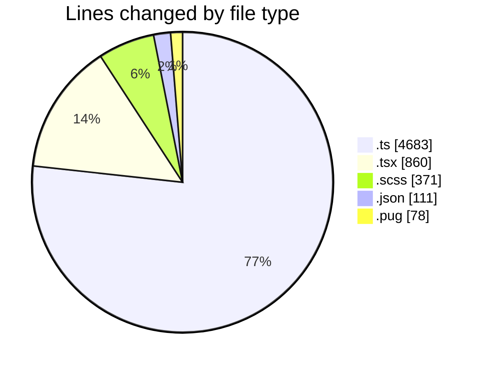
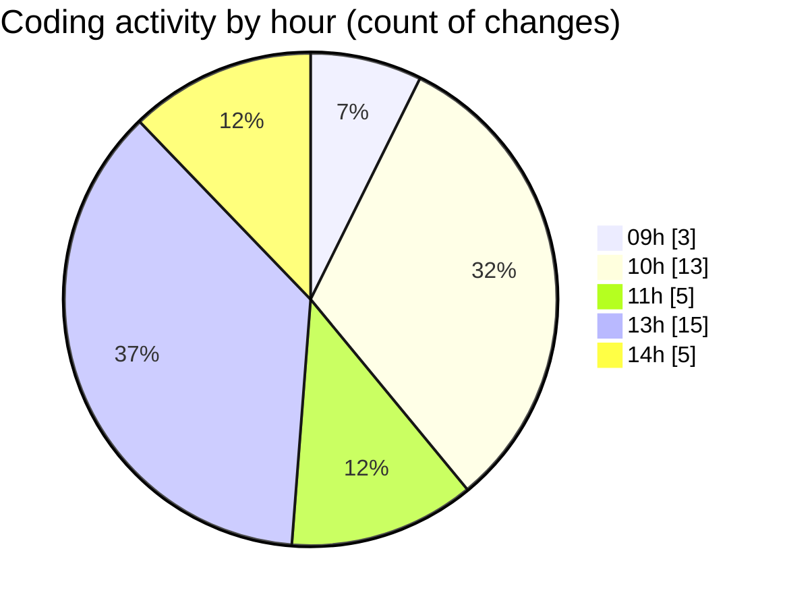

# cda - Activity Summary 

## Overall Statistics

| Stat                   | Value                                                             |
| ---------------------- | ----------------------------------------------------------------- |
| **Lines Added** (➕)   | 5393                                          |
| **Lines Removed** (➖) | 710                                        |
| **Net Change** (↕)    | 4683                |
| **Active Time** (⌚)   | 45 minutes |

## Modified Files
- **AlertService.ts** (+809, -75)
- **AlertService.test.ts** (+2068, -508)
- **SystemService.ts** (+387, -118)
- **SkillTagCreateSubSkill.tsx** (+86, -1)
- **SkillTagAdmin.scss** (+178, -3)
- **settings.json** (+95, -0)
- **App.tsx** (+298, -0)
- **gql.ts** (+520, -0)
- **AlertForm.tsx** (+470, -2)
- **AlertForm.scss** (+190, -0)
- **index.tsx** (+3, -0)
- **ApprovedDomainSystemService.test.ts** (+198, -0)
- **yesalert.json** (+16, -0)
- **html.pug** (+75, -3)

## Visualizations

### By File Type (Lines Changed)

### By Hour (Estimated Activity Count)

> **Last Updated:** 29/10/2026, 14:53:10