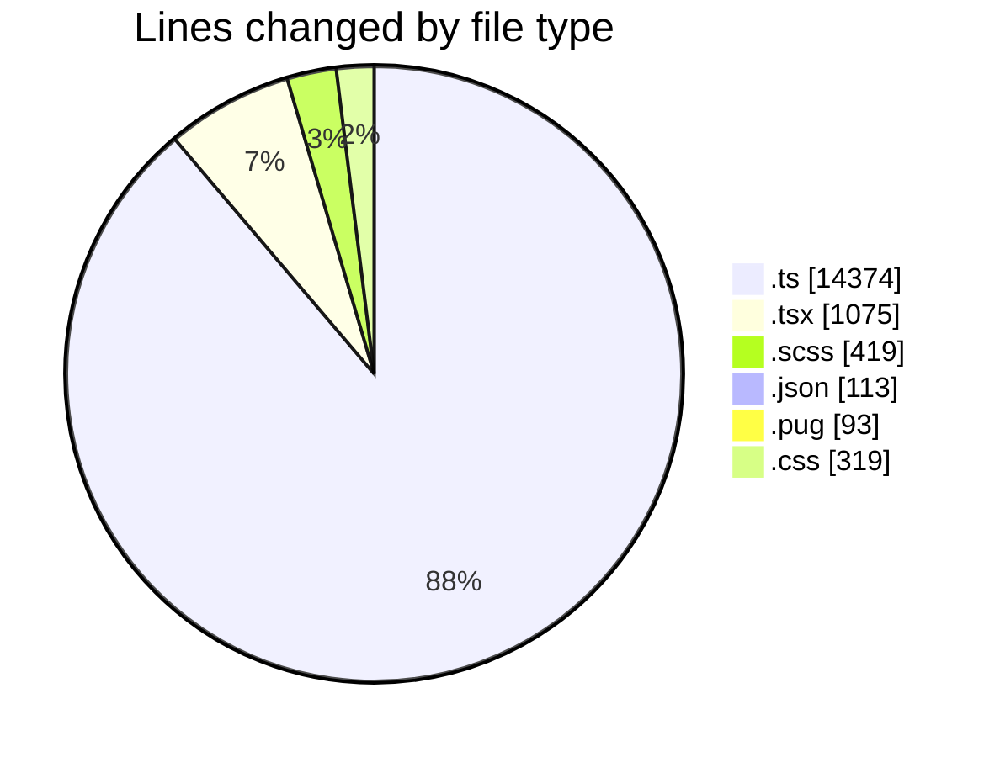
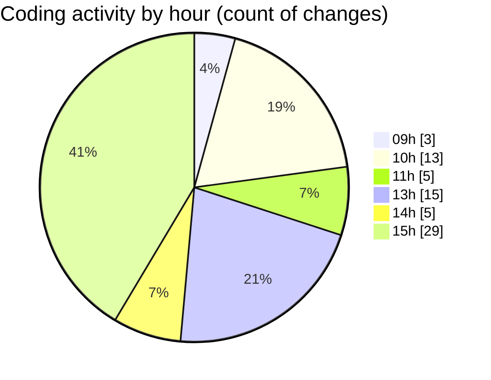

# cda - Activity Summary 

## Overall Statistics

| Stat                   | Value                                                             |
| ---------------------- | ----------------------------------------------------------------- |
| **Lines Added** (➕)   | 14716                                          |
| **Lines Removed** (➖) | 1677                                        |
| **Net Change** (↕)    | 13039                |
| **Active Time** (⌚)   | 74 minutes |

## Modified Files
- **AlertService.ts** (+813, -151)
- **AlertService.test.ts** (+2457, -1022)
- **SystemService.ts** (+387, -236)
- **SkillTagCreateSubSkill.tsx** (+87, -1)
- **SkillTagAdmin.scss** (+178, -3)
- **settings.json** (+95, -0)
- **App.tsx** (+300, -2)
- **gql.ts** (+520, -0)
- **AlertForm.tsx** (+575, -107)
- **AlertForm.scss** (+214, -24)
- **index.tsx** (+3, -0)
- **ApprovedDomainSystemService.test.ts** (+213, -15)
- **yesalert.json** (+17, -1)
- **html.pug** (+85, -8)
- **yesalertTemplate.test.ts** (+43, -0)
- **tables.ts** (+8410, -107)
- **style.css** (+319, -0)

## Visualizations

### By File Type (Lines Changed)

### By Hour (Estimated Activity Count)

> **Last Updated:** 29/10/2026, 15:58:10