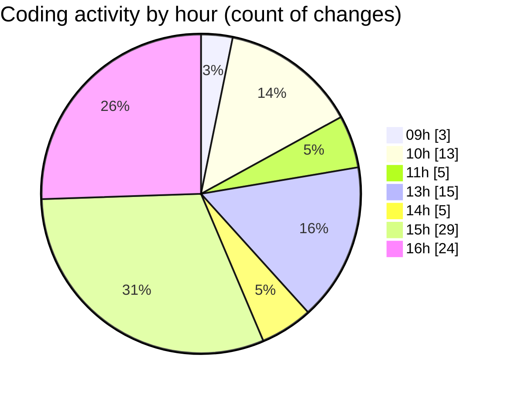

# cda - Activity Summary 

## Overall Statistics

| Stat                   | Value                                                             |
| ---------------------- | ----------------------------------------------------------------- |
| **Lines Added** (➕)   | 27012                                          |
| **Lines Removed** (➖) | 2247                                        |
| **Net Change** (↕)    | 24765                |
| **Active Time** (⌚)   | 121 minutes |

## Modified Files
- **AlertService.ts** (+889, -155)
- **AlertService.test.ts** (+2968, -1408)
- **SystemService.ts** (+505, -236)
- **SkillTagCreateSubSkill.tsx** (+87, -2)
- **SkillTagAdmin.scss** (+178, -3)
- **settings.json** (+95, -0)
- **App.tsx** (+302, -4)
- **gql.ts** (+520, -0)
- **AlertForm.tsx** (+680, -212)
- **AlertForm.scss** (+238, -48)
- **index.tsx** (+3, -0)
- **ApprovedDomainSystemService.test.ts** (+213, -15)
- **yesalert.json** (+18, -2)
- **html.pug** (+90, -13)
- **yesalertTemplate.test.ts** (+44, -1)
- **tables.ts** (+8410, -112)
- **style.css** (+355, -36)
- **views.ts** (+11417, -0)

## Visualizations

### By File Type (Lines Changed)

### By Hour (Estimated Activity Count)

> **Last Updated:** 29/10/2026, 16:13:10