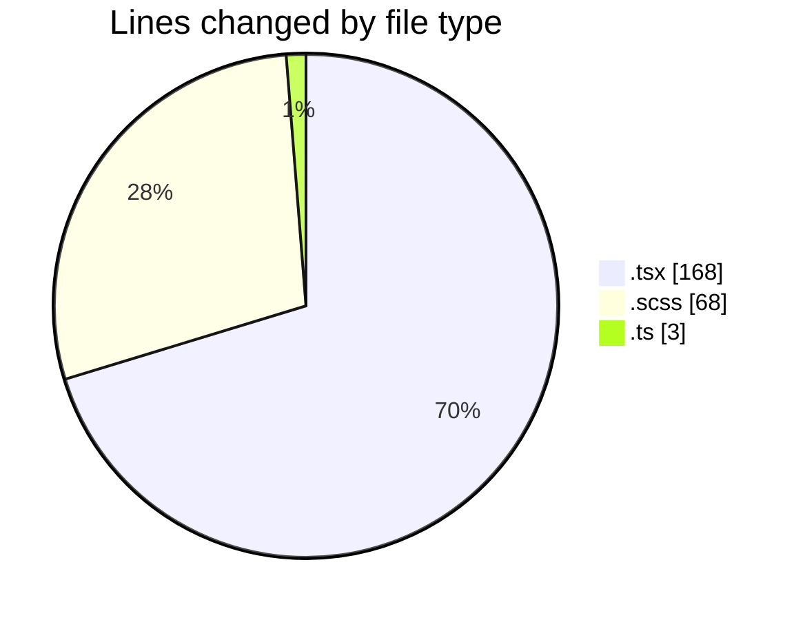
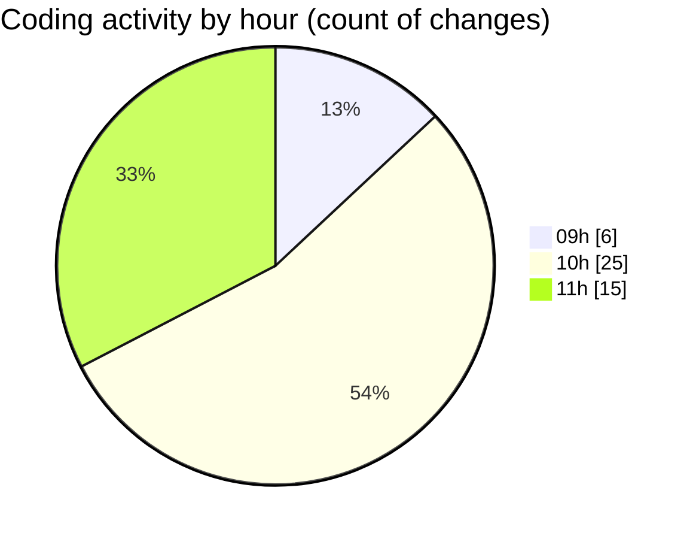

# cda - Activity Summary 

## Overall Statistics

| Stat                   | Value                                                             |
| ---------------------- | ----------------------------------------------------------------- |
| **Lines Added** (➕)   | 201                                          |
| **Lines Removed** (➖) | 38                                        |
| **Net Change** (↕)    | 163                |
| **Active Time** (⌚)   | 53 minutes |

## Modified Files
- **ApprovedUrlModal.tsx** (+109, -28)
- **ApprovedUrlModal.scss** (+41, -5)
- **approvedUrl.ts** (+2, -1)
- **AlertForm.tsx** (+29, -2)
- **AlertForm.scss** (+20, -2)

## Visualizations

### By File Type (Lines Changed)

### By Hour (Estimated Activity Count)

> **Last Updated:** 30/10/2026, 11:43:11