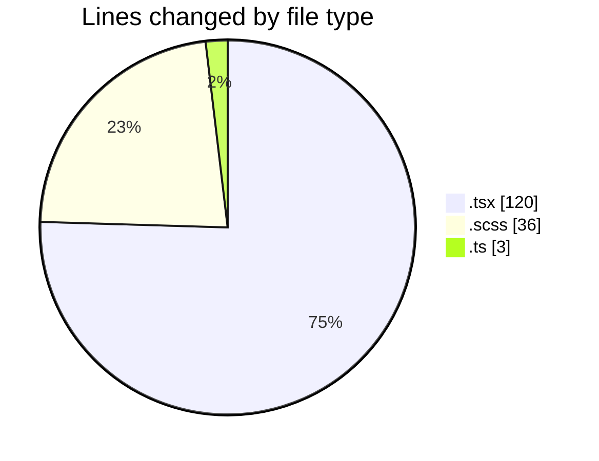
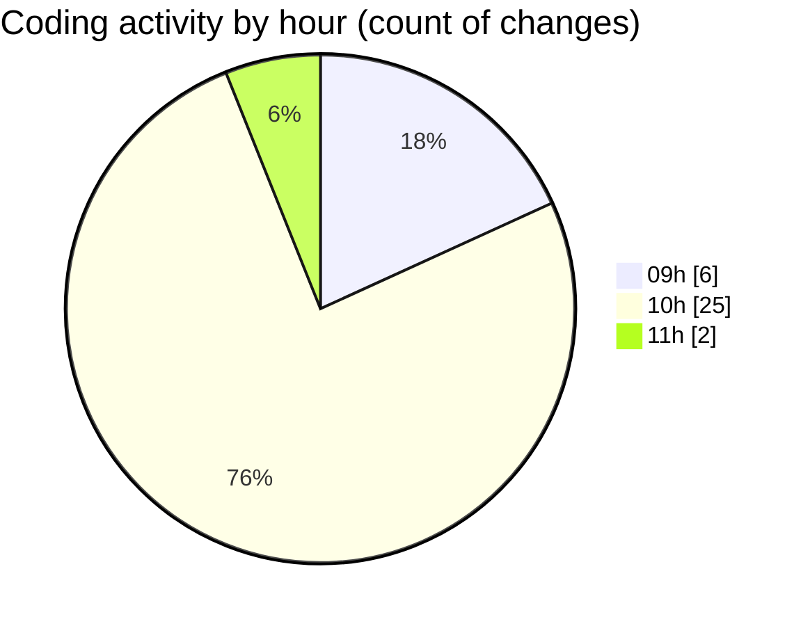

# cda - Activity Summary 

## Overall Statistics

| Stat                   | Value                                                             |
| ---------------------- | ----------------------------------------------------------------- |
| **Lines Added** (➕)   | 124                                          |
| **Lines Removed** (➖) | 35                                        |
| **Net Change** (↕)    | 89                |
| **Active Time** (⌚)   | 39 minutes |

## Modified Files
- **ApprovedUrlModal.tsx** (+69, -28)
- **ApprovedUrlModal.scss** (+31, -5)
- **approvedUrl.ts** (+2, -1)
- **AlertForm.tsx** (+22, -1)

## Visualizations

### By File Type (Lines Changed)

### By Hour (Estimated Activity Count)

> **Last Updated:** 30/10/2026, 11:13:11