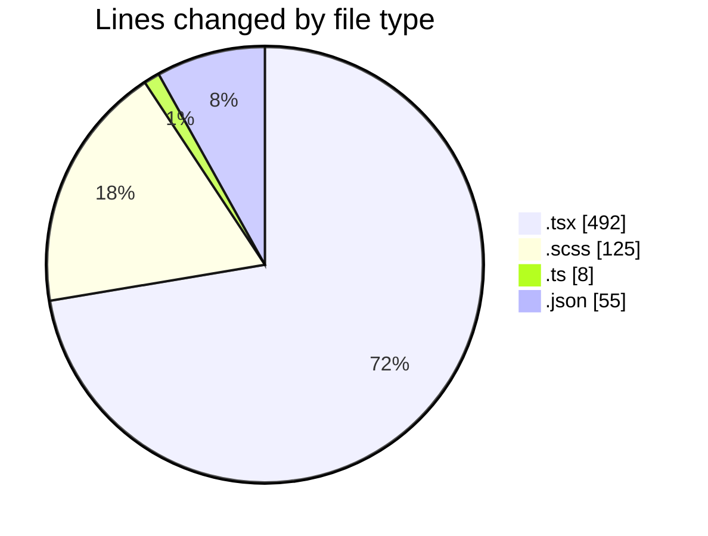
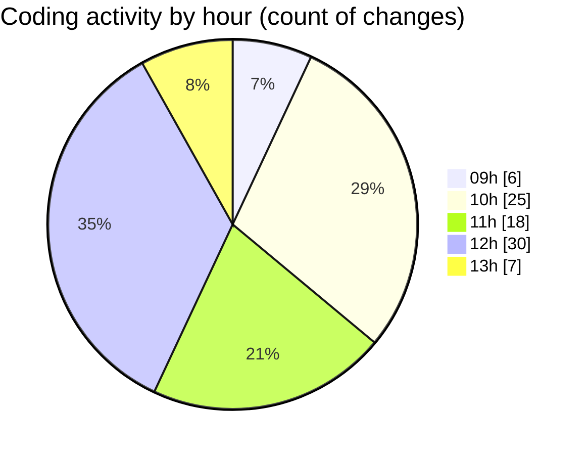

# cda - Activity Summary 

## Overall Statistics

| Stat                   | Value                                                             |
| ---------------------- | ----------------------------------------------------------------- |
| **Lines Added** (➕)   | 525                                          |
| **Lines Removed** (➖) | 155                                        |
| **Net Change** (↕)    | 370                |
| **Active Time** (⌚)   | 118 minutes |

## Modified Files
- **ApprovedUrlModal.tsx** (+195, -125)
- **ApprovedUrlModal.scss** (+81, -22)
- **approvedUrl.ts** (+2, -1)
- **AlertForm.tsx** (+29, -2)
- **AlertForm.scss** (+20, -2)
- **settings.json** (+55, -0)
- **index.ts** (+4, -1)
- **ApprovedUrlForm.tsx** (+72, -2)
- **ApprovedUrlForm.test.tsx** (+67, -0)

## Visualizations

### By File Type (Lines Changed)

### By Hour (Estimated Activity Count)

> **Last Updated:** 30/10/2026, 13:18:11