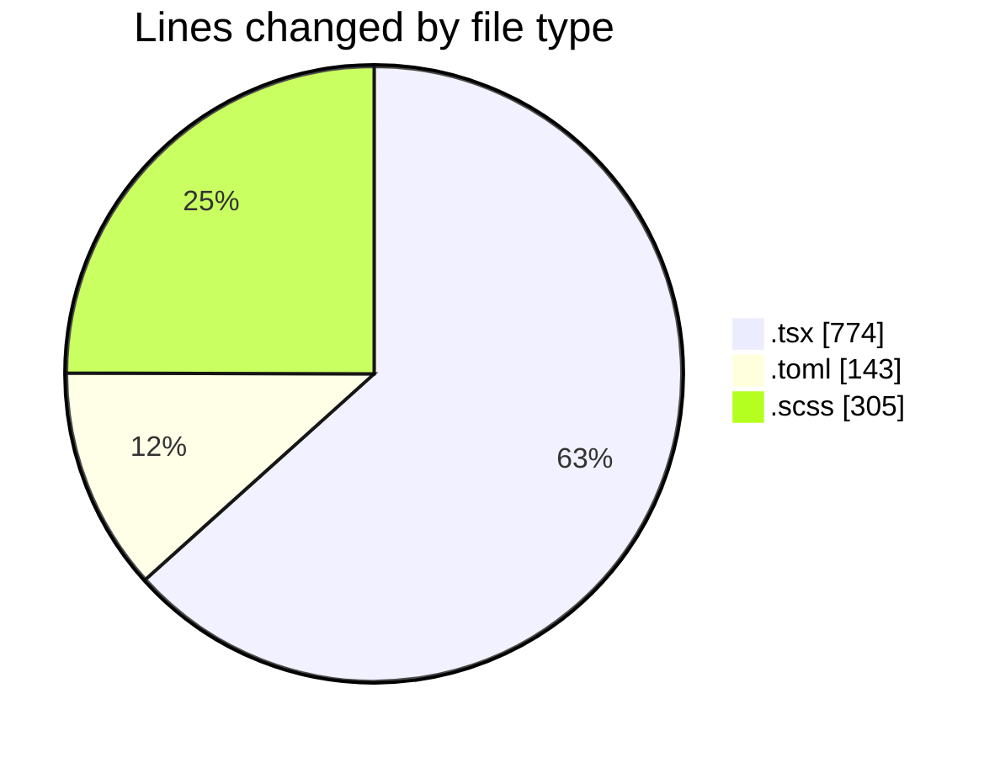
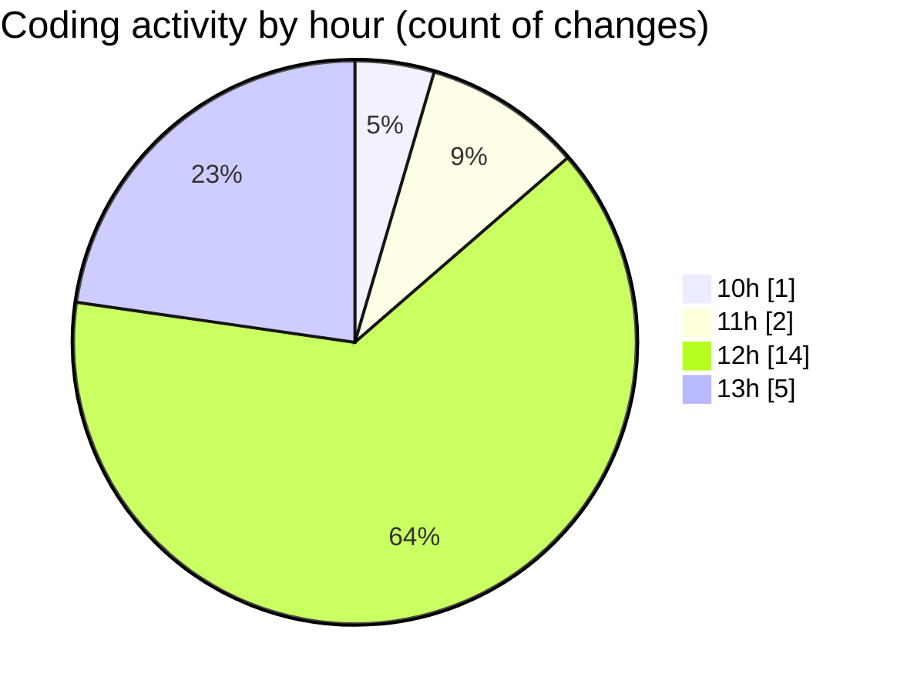

# cda - Activity Summary 

## Overall Statistics

| Stat                   | Value                                                             |
| ---------------------- | ----------------------------------------------------------------- |
| **Lines Added** (➕)   | 1157                                          |
| **Lines Removed** (➖) | 65                                        |
| **Net Change** (↕)    | 1092                |
| **Active Time** (⌚)   | 26 minutes |

## Modified Files
- **ApprovedUrlModal.tsx** (+188, -8)
- **config.toml** (+143, -0)
- **AlertForm.scss** (+250, -55)
- **AlertForm.tsx** (+485, -2)
- **AddApprovedDomainForm.tsx** (+91, -0)

## Visualizations

### By File Type (Lines Changed)

### By Hour (Estimated Activity Count)

> **Last Updated:** 02/11/2026, 13:14:07