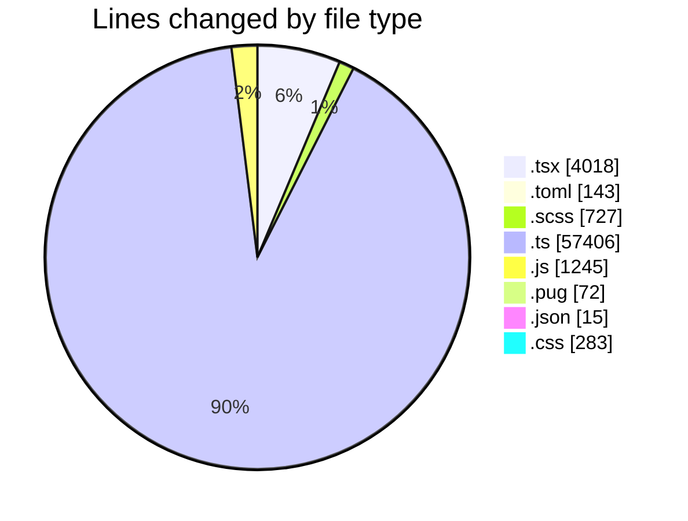
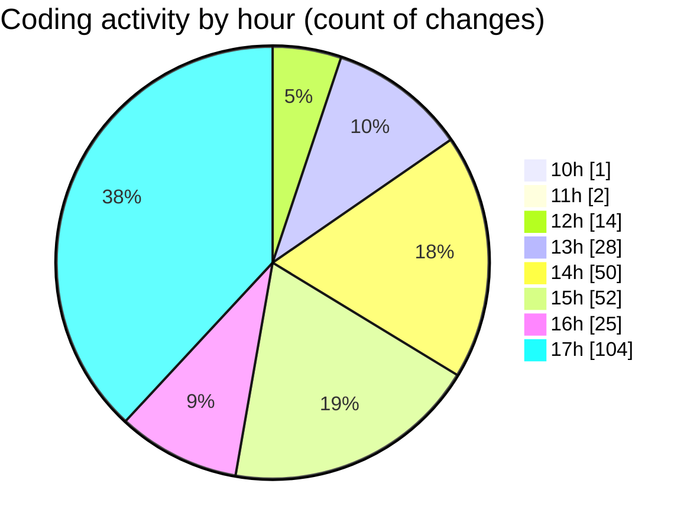

# cda - Activity Summary 

## Overall Statistics

| Stat                   | Value                                                             |
| ---------------------- | ----------------------------------------------------------------- |
| **Lines Added** (➕)   | 62612                                          |
| **Lines Removed** (➖) | 1297                                        |
| **Net Change** (↕)    | 61315                |
| **Active Time** (⌚)   | 390 minutes |

## Modified Files
- **ApprovedUrlModal.tsx** (+190, -8)
- **config.toml** (+143, -0)
- **AlertForm.scss** (+250, -55)
- **AlertForm.tsx** (+485, -9)
- **AddApprovedDomainForm.tsx** (+93, -0)
- **SendAlert.tsx** (+108, -0)
- **SendAlert.test.tsx** (+75, -0)
- **alertCharacterCount.test.tsx** (+145, -0)
- **alertCharacterCount.ts** (+63, -0)
- **ConfigApprovedDomains.tsx** (+298, -55)
- **Config.tsx** (+65, -32)
- **RouteWrapper.tsx** (+226, -14)
- **ConfigApprovedDomains.scss** (+81, -34)
- **ConfigApprovedDomains.test.tsx** (+409, -0)
- **App.tsx** (+338, -40)
- **ConfigPage.tsx** (+27, -7)
- **configPageTitles.ts** (+8, -0)
- **index.ts** (+5, -2)
- **AddApprovedDomain.test.tsx** (+50, -0)
- **AddApprovedDomain.tsx** (+95, -4)
- **AddApprovedDomain.scss** (+88, -0)
- **index.ts** (+3, -0)
- **AddApprovedDomain.test.tsx** (+50, -0)
- **AddDomain.test.tsx** (+66, -0)
- **AddDomain.tsx** (+91, -3)
- **AddDomain.scss** (+134, -85)
- **RouteWrapper.test.tsx** (+239, -7)
- **ConfigStatus.tsx** (+173, -0)
- **ConfigHiddenUserDetails.tsx** (+213, -0)
- **ConfigAlertTypes.tsx** (+151, -0)
- **index.ts** (+6, -2)
- **AddDomain.tsx** (+93, -2)
- **approvedUrl.ts** (+98, -7)
- **approvedUrl.test.ts** (+240, -47)
- **approvedUrl.ts** (+255, -42)
- **AddDomain.test.tsx** (+85, -0)
- **SystemService.ts** (+1081, -295)
- **ApprovedDomainSystemService.test.ts** (+765, -158)
- **ApprovedUrlForm.tsx** (+70, -2)
- **AlertService.ts** (+1691, -37)
- **alertTransformer.ts** (+164, -1)
- **PermissionService.ts** (+933, -0)
- **PermissionService.test.ts** (+2888, -0)
- **AlertService.test.ts** (+4256, -96)
- **MockPermissionsService.ts** (+239, -0)
- **yesalert.js** (+1187, -58)
- **yesalert.ts** (+977, -32)
- **MockSystemService.ts** (+283, -84)
- **yesalert-mutations.ts** (+1406, -37)
- **StaffStatusService.test.ts** (+909, -0)
- **sap_views.ts** (+1892, -1)
- **policies.ts** (+27, -0)
- **AuditService.ts** (+402, -0)
- **resolvers-types.ts** (+17790, -21)
- **YesAlertService.ts** (+211, -0)
- **MockStaffStatusService.ts** (+94, -0)
- **views.ts** (+11466, -20)
- **tables.ts** (+8327, -0)
- **yesalertTemplate.test.ts** (+45, -0)
- **html.pug** (+72, -0)
- **yesalert.json** (+15, -0)
- **style.css** (+283, -0)

## Visualizations

### By File Type (Lines Changed)

### By Hour (Estimated Activity Count)

> **Last Updated:** 02/11/2026, 17:27:23