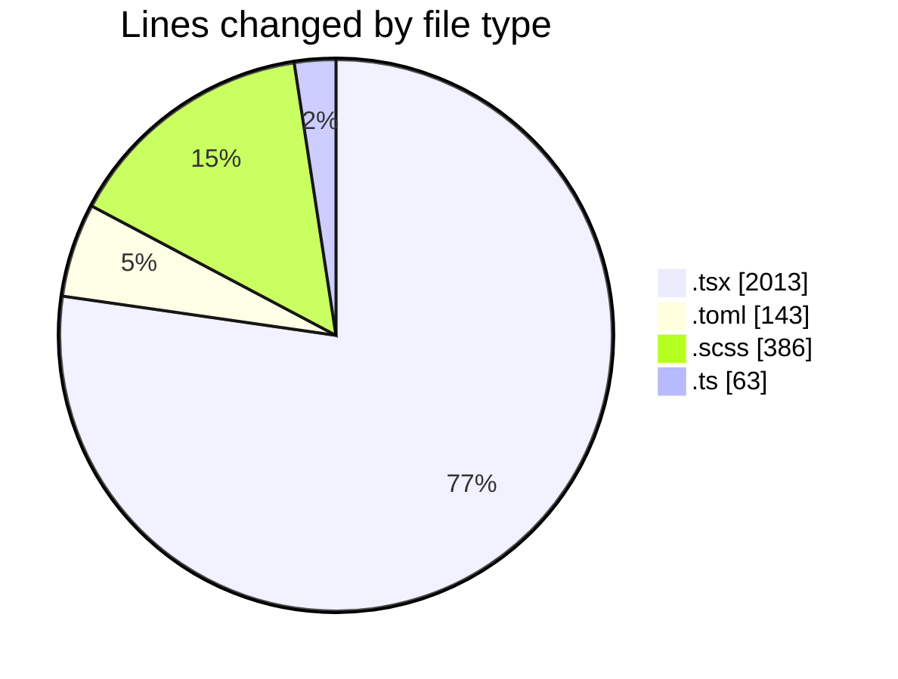
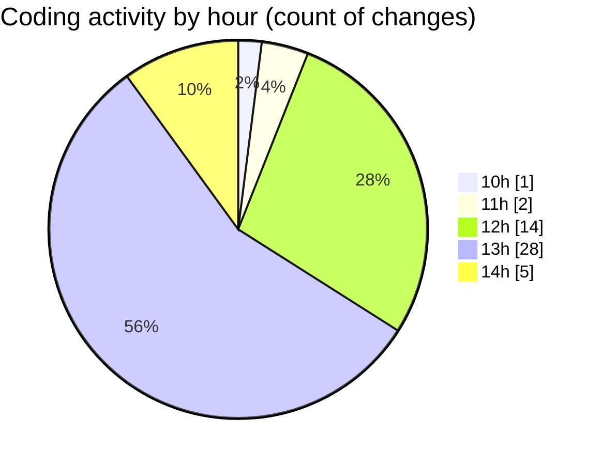

# cda - Activity Summary 

## Overall Statistics

| Stat                   | Value                                                             |
| ---------------------- | ----------------------------------------------------------------- |
| **Lines Added** (➕)   | 2500                                          |
| **Lines Removed** (➖) | 105                                        |
| **Net Change** (↕)    | 2395                |
| **Active Time** (⌚)   | 72 minutes |

## Modified Files
- **ApprovedUrlModal.tsx** (+188, -8)
- **config.toml** (+143, -0)
- **AlertForm.scss** (+250, -55)
- **AlertForm.tsx** (+485, -9)
- **AddApprovedDomainForm.tsx** (+93, -0)
- **SendAlert.tsx** (+108, -0)
- **SendAlert.test.tsx** (+75, -0)
- **alertCharacterCount.test.tsx** (+145, -0)
- **alertCharacterCount.ts** (+63, -0)
- **ConfigApprovedDomains.tsx** (+271, -25)
- **Config.tsx** (+32, -4)
- **RouteWrapper.tsx** (+216, -4)
- **ConfigApprovedDomains.scss** (+81, -0)
- **ConfigApprovedDomains.test.tsx** (+350, -0)

## Visualizations

### By File Type (Lines Changed)

### By Hour (Estimated Activity Count)

> **Last Updated:** 02/11/2026, 14:14:07