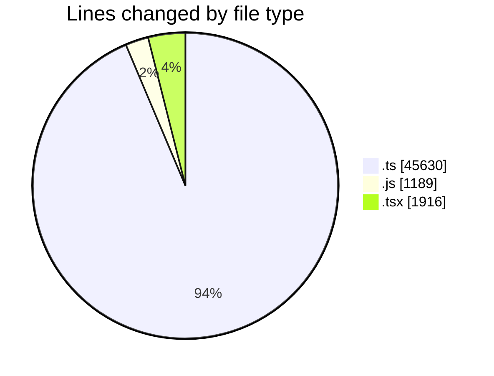
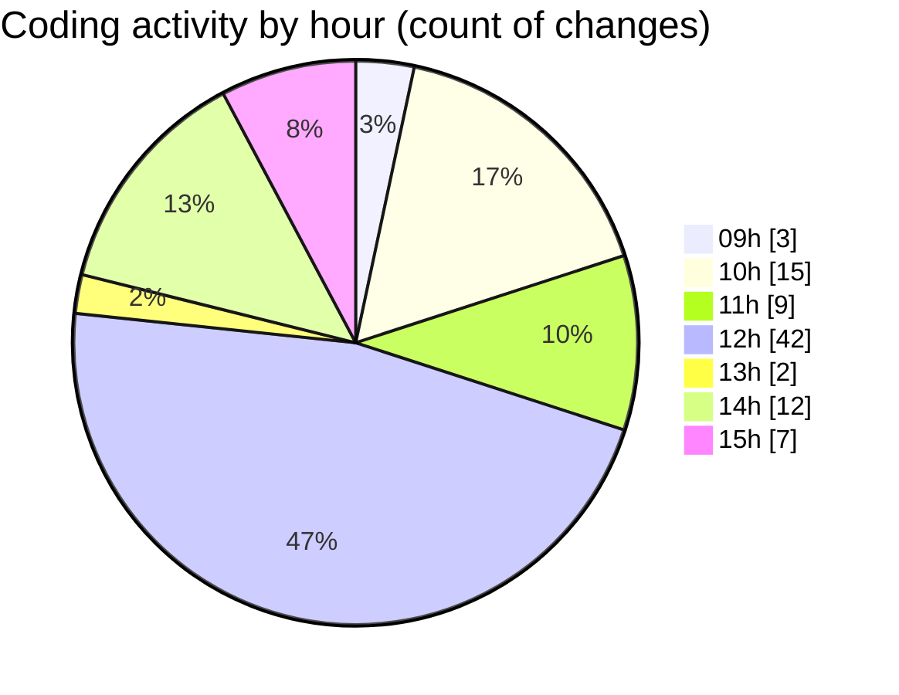

# cda - Activity Summary 

## Overall Statistics

| Stat                   | Value                                                             |
| ---------------------- | ----------------------------------------------------------------- |
| **Lines Added** (➕)   | 48437                                          |
| **Lines Removed** (➖) | 298                                        |
| **Net Change** (↕)    | 48139                |
| **Active Time** (⌚)   | 151 minutes |

## Modified Files
- **SystemService.ts** (+469, -36)
- **ApprovedDomainSystemService.test.ts** (+529, -118)
- **20261023123500-create-yesalert-approved-domains-view.js** (+14, -2)
- **AlertService.test.ts** (+2169, -20)
- **20261023110503-create-yesalert-approved-domain-table.js** (+27, -1)
- **vulcan.ts** (+1724, -0)
- **views.ts** (+11470, -0)
- **tables.ts** (+8351, -0)
- **20261023123501-create-yesalert-approved-domains-view.js** (+13, -1)
- **yesalert.js** (+1131, -0)
- **MockSystemService.ts** (+208, -3)
- **AlertService.ts** (+887, -56)
- **ApprovedUrlService.ts** (+73, -0)
- **YesAlertService.ts** (+216, -1)
- **resolvers-types.ts** (+17798, -4)
- **system.ts** (+442, -0)
- **yesalert.ts** (+945, -0)
- **approvedUrl.ts** (+52, -6)
- **approvedUrl.test.ts** (+45, -8)
- **RouteWrapper.tsx** (+212, -0)
- **ConfigApprovedDomains.tsx** (+300, -0)
- **NewAlert.test.tsx** (+639, -0)
- **NewAlert.tsx** (+416, -42)
- **ApprovedUrlModal.tsx** (+190, -0)
- **ApprovedUrlModal.test.tsx** (+117, -0)

## Visualizations

### By File Type (Lines Changed)

### By Hour (Estimated Activity Count)

> **Last Updated:** 03/11/2026, 16:01:40