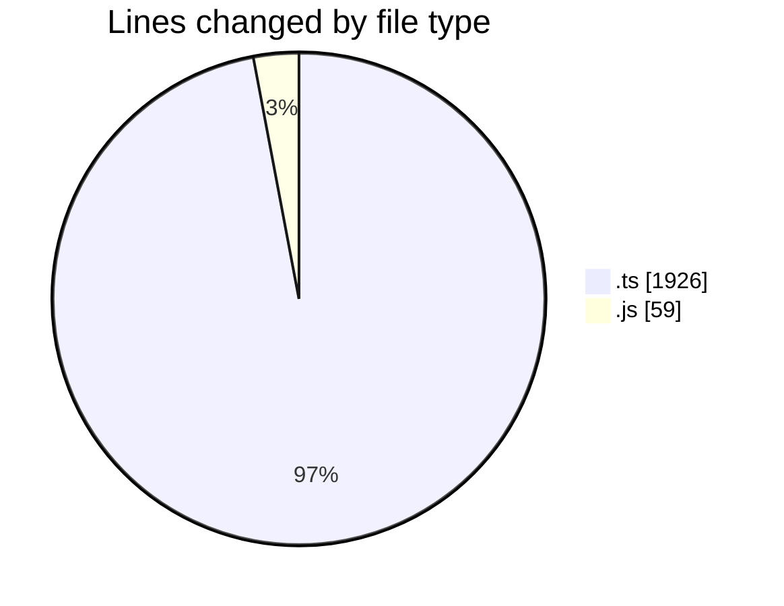
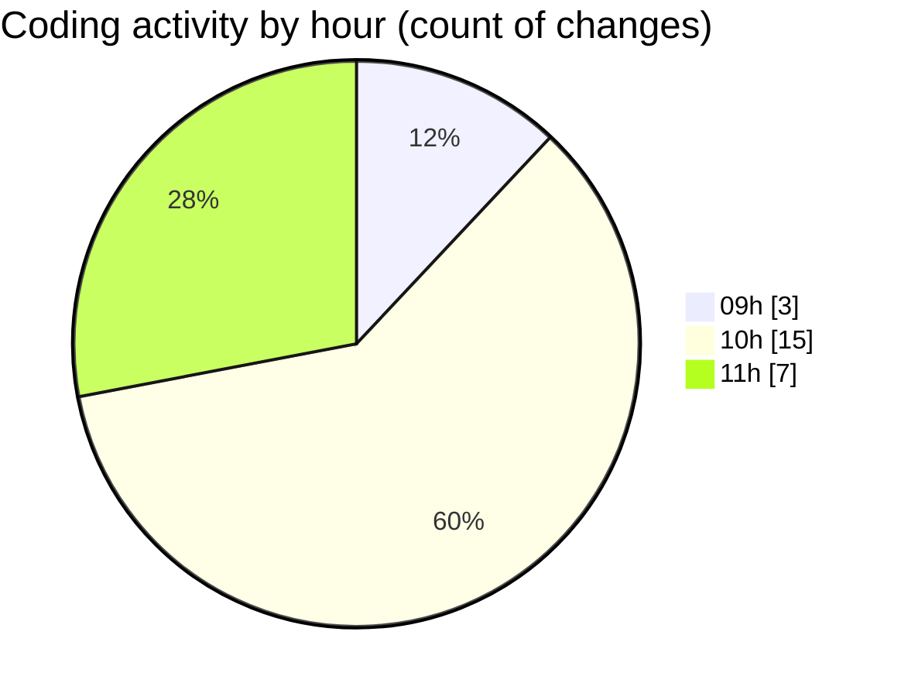

# cda - Activity Summary 

## Overall Statistics

| Stat                   | Value                                                             |
| ---------------------- | ----------------------------------------------------------------- |
| **Lines Added** (➕)   | 1972                                          |
| **Lines Removed** (➖) | 13                                        |
| **Net Change** (↕)    | 1959                |
| **Active Time** (⌚)   | 27 minutes |

## Modified Files
- **SystemService.ts** (+22, -9)
- **ApprovedDomainSystemService.test.ts** (+65, -0)
- **20261023123500-create-yesalert-approved-domains-view.js** (+14, -2)
- **AlertService.test.ts** (+37, -0)
- **20261023110503-create-yesalert-approved-domain-table.js** (+27, -1)
- **vulcan.ts** (+1724, -0)
- **views.ts** (+12, -0)
- **tables.ts** (+12, -0)
- **20261023123501-create-yesalert-approved-domains-view.js** (+13, -1)
- **yesalert.js** (+1, -0)
- **MockSystemService.ts** (+3, -0)
- **AlertService.ts** (+42, -0)

## Visualizations

### By File Type (Lines Changed)

### By Hour (Estimated Activity Count)

> **Last Updated:** 03/11/2026, 11:32:24