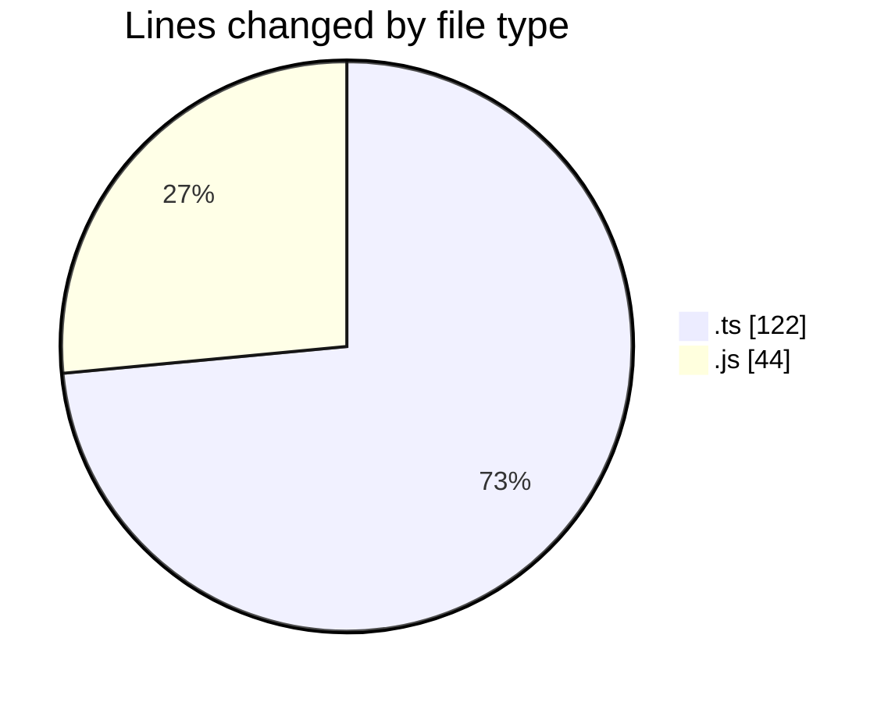
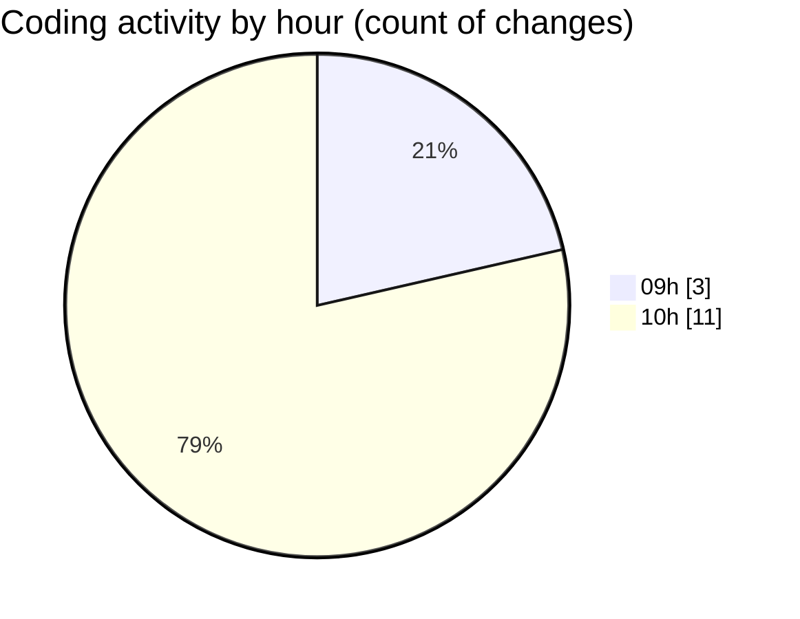

# cda - Activity Summary 

## Overall Statistics

| Stat                   | Value                                                             |
| ---------------------- | ----------------------------------------------------------------- |
| **Lines Added** (➕)   | 163                                          |
| **Lines Removed** (➖) | 3                                        |
| **Net Change** (↕)    | 160                |
| **Active Time** (⌚)   | 19 minutes |

## Modified Files
- **SystemService.ts** (+20, -0)
- **ApprovedDomainSystemService.test.ts** (+65, -0)
- **20261023123500-create-yesalert-approved-domains-view.js** (+14, -2)
- **AlertService.test.ts** (+37, -0)
- **20261023110503-create-yesalert-approved-domain-table.js** (+27, -1)

## Visualizations

### By File Type (Lines Changed)

### By Hour (Estimated Activity Count)

> **Last Updated:** 03/11/2026, 10:12:24