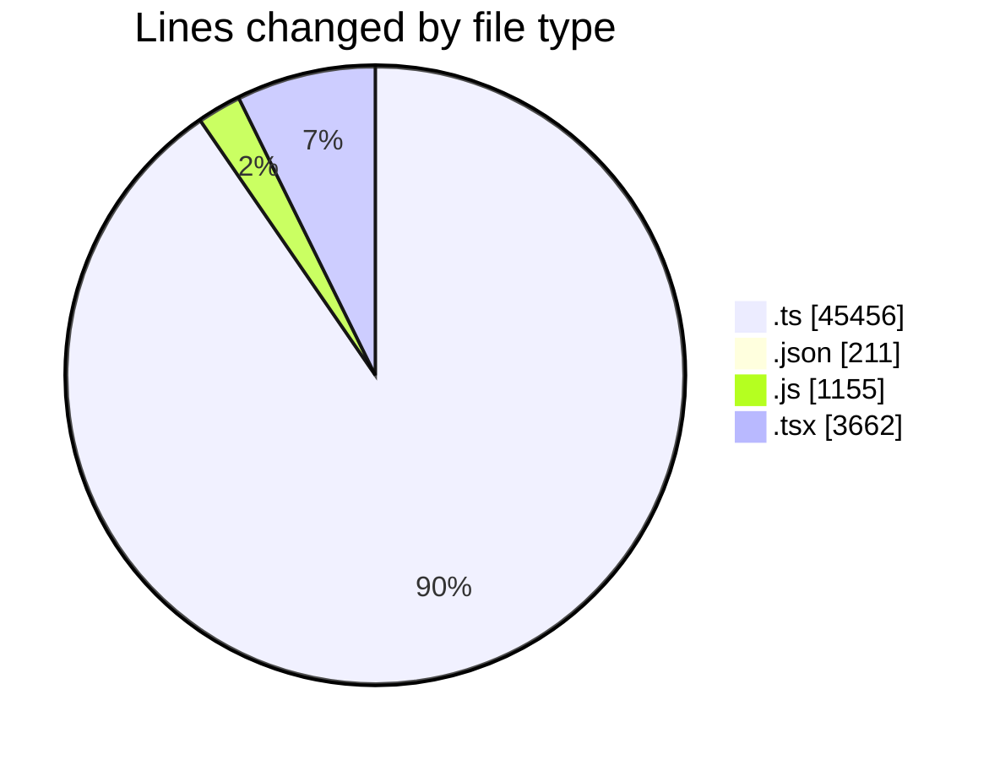
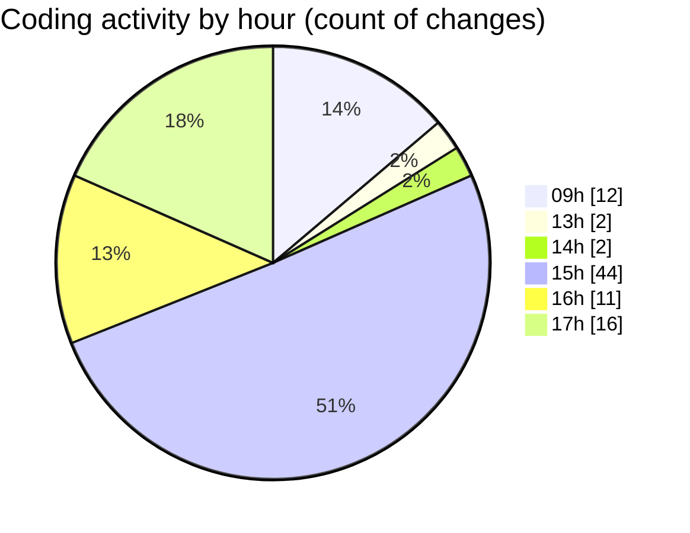

# cda - Activity Summary 

## Overall Statistics

| Stat                   | Value                                                             |
| ---------------------- | ----------------------------------------------------------------- |
| **Lines Added** (➕)   | 49441                                          |
| **Lines Removed** (➖) | 1043                                        |
| **Net Change** (↕)    | 48398                |
| **Active Time** (⌚)   | 83 minutes |

## Modified Files
- **SystemService.ts** (+1111, -302)
- **settings.json** (+206, -5)
- **system.ts** (+488, -111)
- **AlertService.ts** (+795, -3)
- **yesalert.js** (+1145, -10)
- **yesalert.ts** (+953, -4)
- **resolvers-types.ts** (+17808, -7)
- **AuditService.ts** (+406, -0)
- **YesAlertService.ts** (+225, -5)
- **MockSystemService.ts** (+202, -41)
- **MockUrlService.ts** (+59, -16)
- **ApprovedDomainSystemService.test.ts** (+636, -145)
- **AlertService.test.ts** (+2188, -38)
- **approvedUrl.test.ts** (+41, -4)
- **approvedUrl.ts** (+49, -3)
- **RouteWrapper.tsx** (+212, -0)
- **graphql.ts** (+8131, -0)
- **AlertForm.tsx** (+476, -113)
- **Home.tsx** (+369, -0)
- **ApprovedUrlForm.test.tsx** (+59, -0)
- **config.ts** (+48, -0)
- **approvedUrl.ts** (+44, -2)
- **ApprovedUrlForm.tsx** (+68, -2)
- **ApprovedUrlModal.test.tsx** (+180, -0)
- **approvedDomains.ts** (+36, -0)
- **graphql.ts** (+10926, -0)
- **gql.ts** (+526, -0)
- **approvedDomains.ts** (+50, -0)
- **useApprovedDomains.ts** (+53, -0)
- **NewAlert.test.tsx** (+742, -230)
- **ConfigApprovedDomains.tsx** (+338, -0)
- **ConfigApprovedDomains.test.tsx** (+676, -0)
- **ApprovedUrlModal.tsx** (+195, -2)

## Visualizations

### By File Type (Lines Changed)

### By Hour (Estimated Activity Count)

> **Last Updated:** 04/11/2026, 17:32:59