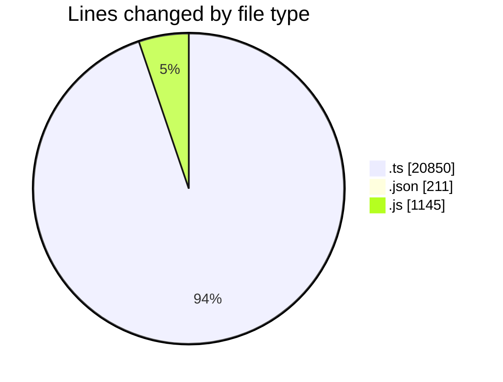
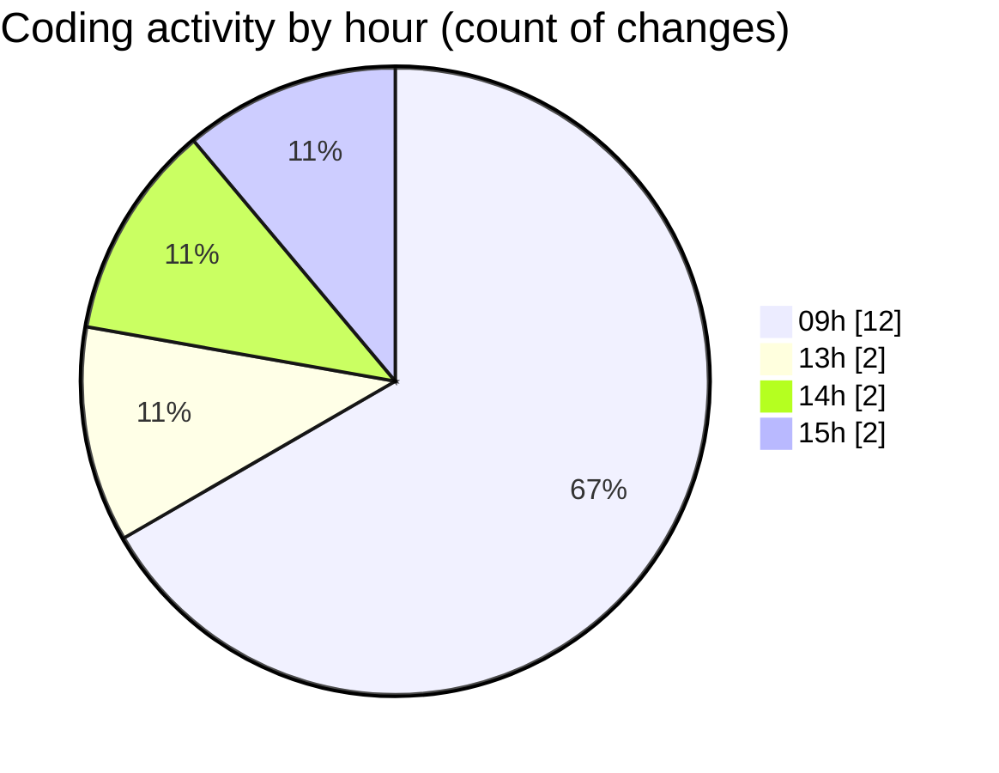

# cda - Activity Summary 

## Overall Statistics

| Stat                   | Value                                                             |
| ---------------------- | ----------------------------------------------------------------- |
| **Lines Added** (➕)   | 22044                                          |
| **Lines Removed** (➖) | 162                                        |
| **Net Change** (↕)    | 21882                |
| **Active Time** (⌚)   | 12 minutes |

## Modified Files
- **SystemService.ts** (+691, -152)
- **settings.json** (+206, -5)
- **system.ts** (+465, -0)
- **AlertService.ts** (+792, -0)
- **yesalert.js** (+1140, -5)
- **yesalert.ts** (+949, -0)
- **resolvers-types.ts** (+17801, -0)

## Visualizations

### By File Type (Lines Changed)

### By Hour (Estimated Activity Count)

> **Last Updated:** 04/11/2026, 15:32:59