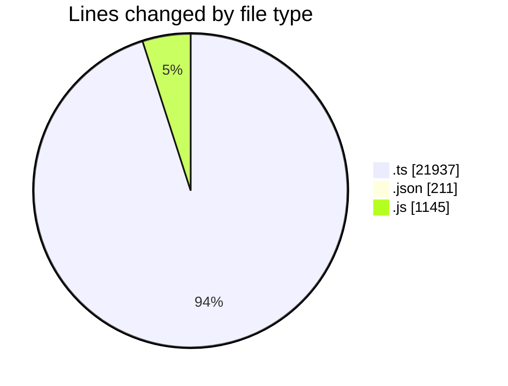
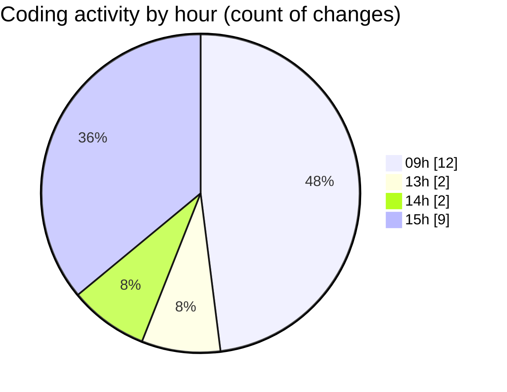

# cda - Activity Summary 

## Overall Statistics

| Stat                   | Value                                                             |
| ---------------------- | ----------------------------------------------------------------- |
| **Lines Added** (➕)   | 23130                                          |
| **Lines Removed** (➖) | 163                                        |
| **Net Change** (↕)    | 22967                |
| **Active Time** (⌚)   | 23 minutes |

## Modified Files
- **SystemService.ts** (+961, -152)
- **settings.json** (+206, -5)
- **system.ts** (+465, -0)
- **AlertService.ts** (+792, -0)
- **yesalert.js** (+1140, -5)
- **yesalert.ts** (+949, -0)
- **resolvers-types.ts** (+17801, -0)
- **AuditService.ts** (+406, -0)
- **YesAlertService.ts** (+220, -0)
- **MockSystemService.ts** (+161, -0)
- **MockUrlService.ts** (+29, -1)

## Visualizations

### By File Type (Lines Changed)

### By Hour (Estimated Activity Count)

> **Last Updated:** 04/11/2026, 15:37:59