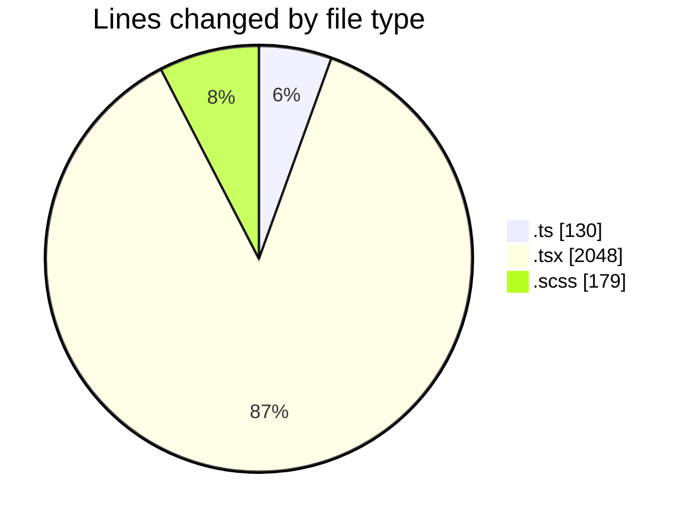
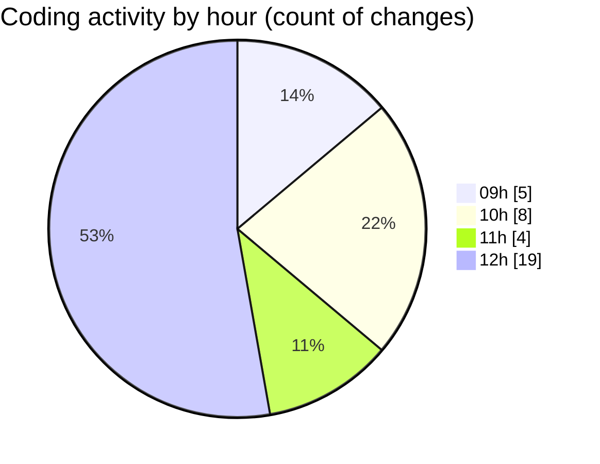

# cda - Activity Summary 

## Overall Statistics

| Stat                   | Value                                                             |
| ---------------------- | ----------------------------------------------------------------- |
| **Lines Added** (➕)   | 1634                                          |
| **Lines Removed** (➖) | 723                                        |
| **Net Change** (↕)    | 911                |
| **Active Time** (⌚)   | 40 minutes |

## Modified Files
- **system.ts** (+88, -0)
- **AlertForm.tsx** (+339, -226)
- **NewAlert.test.tsx** (+690, -460)
- **RouteWrapper.tsx** (+8, -8)
- **ConfigApprovedDomains.tsx** (+19, -4)
- **ConfigApprovedDomains.scss** (+76, -8)
- **AddDomain.tsx** (+112, -1)
- **normaliseApprovedHost.ts** (+42, -0)
- **InlineUpdateButton.tsx** (+181, -0)
- **AddDomain.scss** (+79, -16)

## Visualizations

### By File Type (Lines Changed)

### By Hour (Estimated Activity Count)

> **Last Updated:** 05/11/2026, 12:47:59