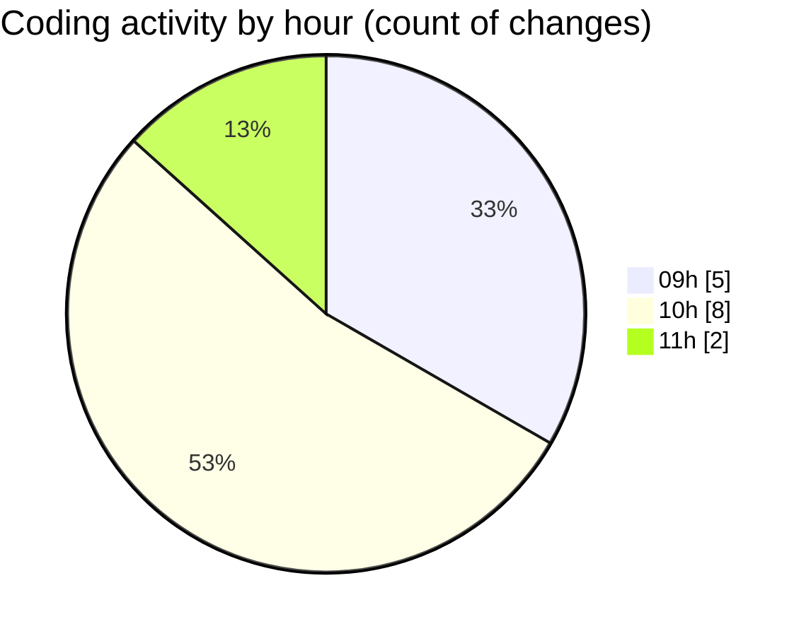

# cda - Activity Summary 

## Overall Statistics

| Stat                   | Value                                                             |
| ---------------------- | ----------------------------------------------------------------- |
| **Lines Added** (➕)   | 1209                                          |
| **Lines Removed** (➖) | 694                                        |
| **Net Change** (↕)    | 515                |
| **Active Time** (⌚)   | 7 minutes |

## Modified Files
- **system.ts** (+88, -0)
- **AlertForm.tsx** (+339, -226)
- **NewAlert.test.tsx** (+690, -460)
- **RouteWrapper.tsx** (+8, -8)
- **ConfigApprovedDomains.tsx** (+18, -0)
- **ConfigApprovedDomains.scss** (+66, -0)

## Visualizations

### By File Type (Lines Changed)

### By Hour (Estimated Activity Count)

> **Last Updated:** 05/11/2026, 11:57:59