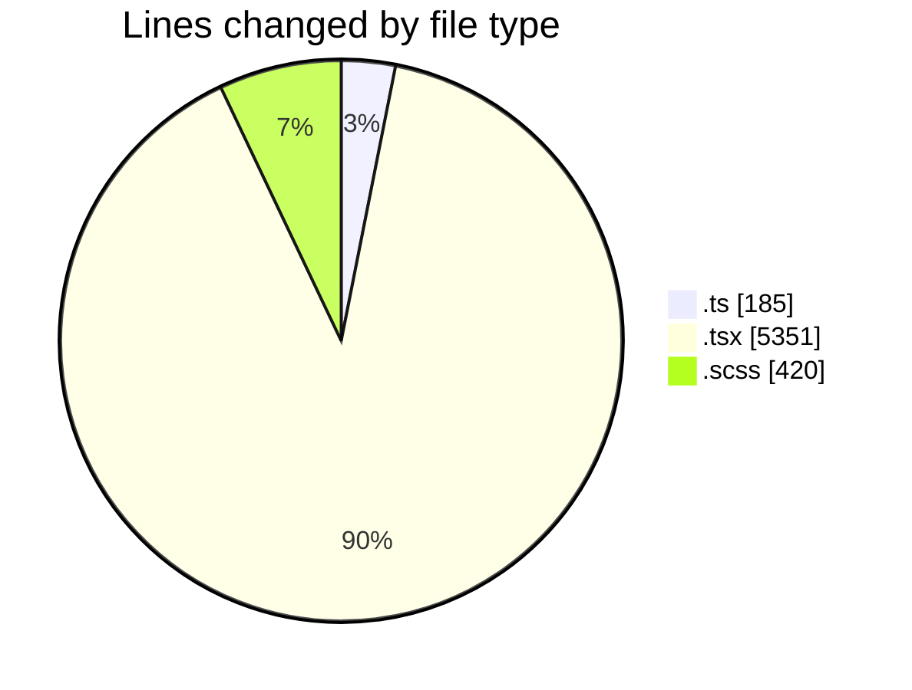
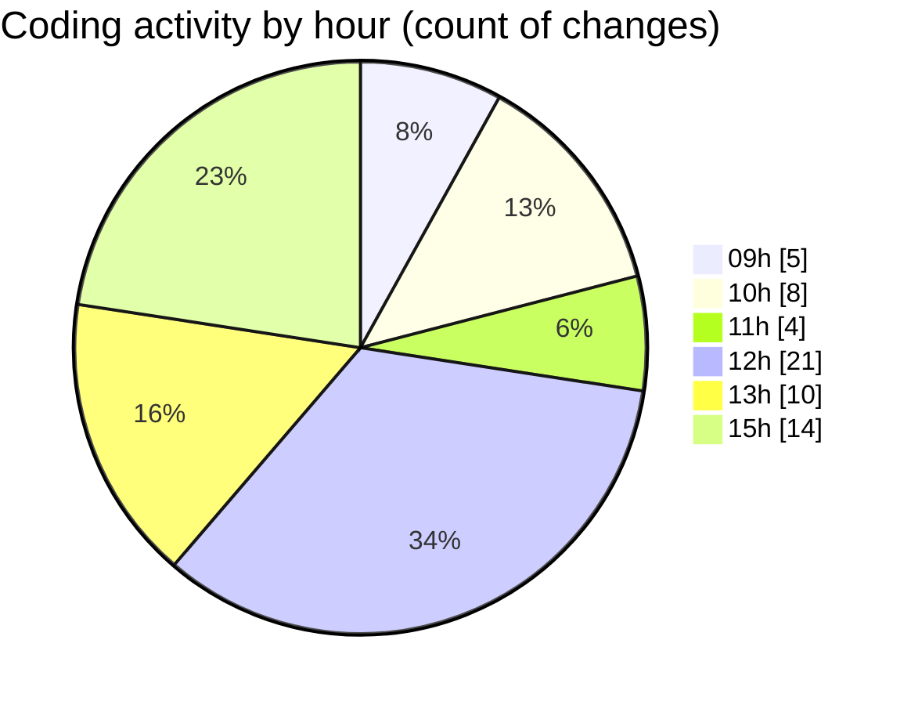

# cda - Activity Summary 

## Overall Statistics

| Stat                   | Value                                                             |
| ---------------------- | ----------------------------------------------------------------- |
| **Lines Added** (➕)   | 5216                                          |
| **Lines Removed** (➖) | 740                                        |
| **Net Change** (↕)    | 4476                |
| **Active Time** (⌚)   | 76 minutes |

## Modified Files
- **system.ts** (+88, -0)
- **AlertForm.tsx** (+815, -226)
- **NewAlert.test.tsx** (+690, -460)
- **RouteWrapper.tsx** (+8, -8)
- **ConfigApprovedDomains.tsx** (+19, -4)
- **ConfigApprovedDomains.scss** (+76, -8)
- **AddDomain.tsx** (+113, -4)
- **normaliseApprovedHost.ts** (+42, -0)
- **InlineUpdateButton.tsx** (+181, -0)
- **AddDomain.scss** (+83, -24)
- **normaliseApprovedHost.test.ts** (+50, -0)
- **index.ts** (+4, -1)
- **ApprovedUrlModal.test.tsx** (+522, -0)
- **AddDomain.test.tsx** (+150, -0)
- **ConfigApprovedDomains.test.tsx** (+43, -0)
- **AlertForm.test.tsx** (+1154, -0)
- **NewTemplate.tsx** (+339, -0)
- **TemplateDetail.tsx** (+312, -3)
- **ApprovedUrlModal.tsx** (+209, -0)
- **EmailVisualisation.tsx** (+91, -0)
- **EmailVisualisation.scss** (+227, -2)

## Visualizations

### By File Type (Lines Changed)

### By Hour (Estimated Activity Count)

> **Last Updated:** 05/11/2026, 15:33:54