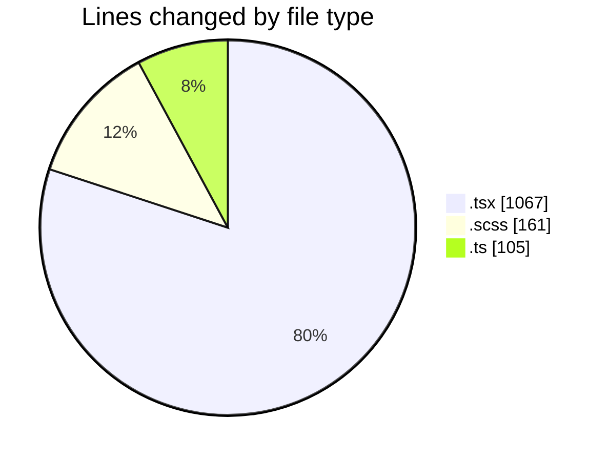
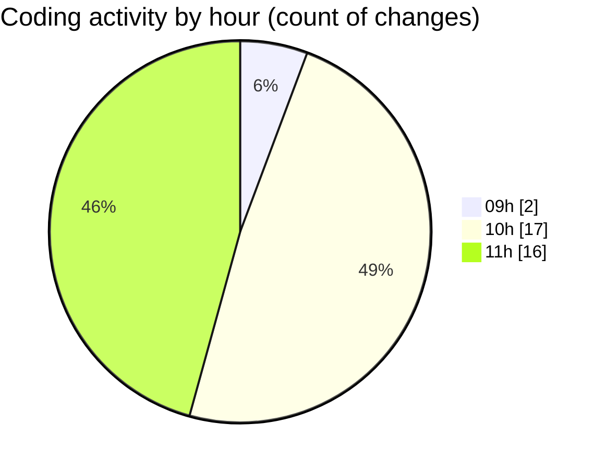

# cda - Activity Summary 

## Overall Statistics

| Stat                   | Value                                                             |
| ---------------------- | ----------------------------------------------------------------- |
| **Lines Added** (➕)   | 1118                                          |
| **Lines Removed** (➖) | 215                                        |
| **Net Change** (↕)    | 903                |
| **Active Time** (⌚)   | 41 minutes |

## Modified Files
- **ApprovedUrlModal.tsx** (+44, -30)
- **ApprovedUrlModal.test.tsx** (+31, -131)
- **AddDomain.scss** (+61, -0)
- **AddDomain.test.tsx** (+174, -3)
- **AddDomain.tsx** (+128, -3)
- **ConfigApprovedDomains.test.tsx** (+6, -39)
- **ApprovedUrlModal.scss** (+49, -0)
- **normaliseApprovedHost.ts** (+47, -0)
- **normaliseApprovedHost.test.ts** (+55, -0)
- **ConfigApprovedDomains.tsx** (+15, -8)
- **ConfirmActionModal.tsx** (+49, -0)
- **AddDomain.scss** (+50, -1)
- **AddDomain.test.tsx** (+236, -0)
- **AddDomain.tsx** (+170, -0)
- **index.ts** (+3, -0)

## Visualizations

### By File Type (Lines Changed)

### By Hour (Estimated Activity Count)

> **Last Updated:** 06/11/2026, 11:33:55