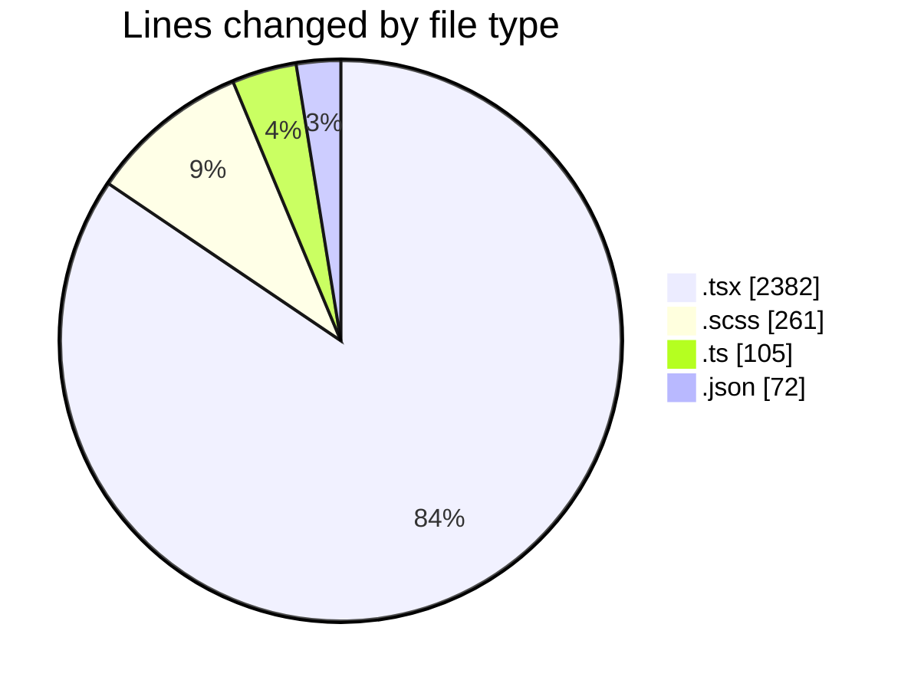
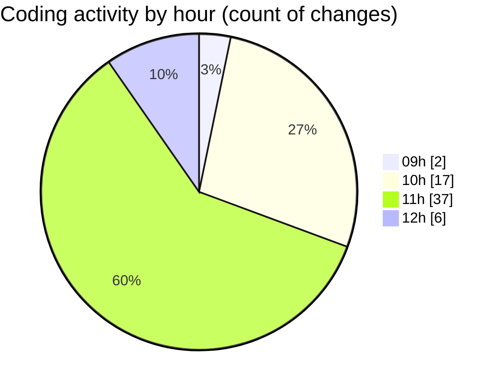

# cda - Activity Summary 

## Overall Statistics

| Stat                   | Value                                                             |
| ---------------------- | ----------------------------------------------------------------- |
| **Lines Added** (➕)   | 2526                                          |
| **Lines Removed** (➖) | 294                                        |
| **Net Change** (↕)    | 2232                |
| **Active Time** (⌚)   | 88 minutes |

## Modified Files
- **ApprovedUrlModal.tsx** (+44, -35)
- **ApprovedUrlModal.test.tsx** (+47, -131)
- **AddDomain.scss** (+61, -0)
- **AddDomain.test.tsx** (+174, -3)
- **AddDomain.tsx** (+128, -3)
- **ConfigApprovedDomains.test.tsx** (+28, -43)
- **ApprovedUrlModal.scss** (+49, -0)
- **normaliseApprovedHost.ts** (+47, -0)
- **normaliseApprovedHost.test.ts** (+55, -0)
- **ConfigApprovedDomains.tsx** (+23, -16)
- **ConfirmActionModal.tsx** (+49, -0)
- **AddDomain.scss** (+61, -25)
- **AddDomain.test.tsx** (+241, -6)
- **AddDomain.tsx** (+195, -24)
- **index.ts** (+3, -0)
- **ConfigApprovedDomains.scss** (+65, -0)
- **NewAlert.tsx** (+381, -8)
- **NewAlert.test.tsx** (+796, -0)
- **package.json** (+72, -0)
- **AlertForm.tsx** (+7, -0)

## Visualizations

### By File Type (Lines Changed)

### By Hour (Estimated Activity Count)

> **Last Updated:** 06/11/2026, 12:28:55