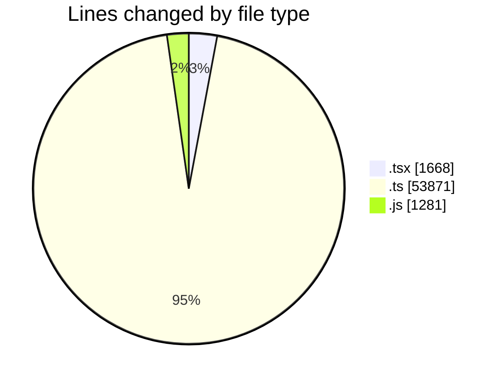
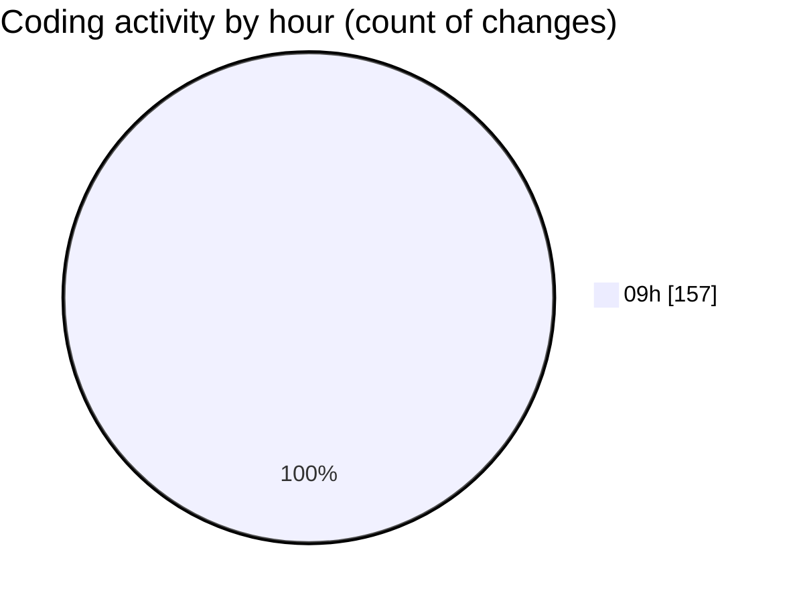

# cda - Activity Summary 

## Overall Statistics

| Stat                   | Value                                                             |
| ---------------------- | ----------------------------------------------------------------- |
| **Lines Added** (➕)   | 53347                                          |
| **Lines Removed** (➖) | 3473                                        |
| **Net Change** (↕)    | 49874                |
| **Active Time** (⌚)   | 168 minutes |

## Modified Files
- **NewAlert.tsx** (+589, -216)
- **system.ts** (+1094, -558)
- **approvedUrl.test.ts** (+41, -4)
- **approvedUrl.ts** (+46, -0)
- **RouteWrapper.tsx** (+234, -22)
- **AlertService.ts** (+849, -57)
- **AuditService.ts** (+422, -16)
- **yesalert.ts** (+1018, -69)
- **yesalert.js** (+1208, -73)
- **MockStaffStatusService.ts** (+96, -1)
- **SystemService.ts** (+376, -106)
- **policies.ts** (+36, -8)
- **MockSystemService.ts** (+192, -31)
- **StaffStatusService.test.ts** (+1116, -206)
- **alertTransformer.ts** (+82, -1)
- **YesAlertService.ts** (+240, -20)
- **AlertService.test.ts** (+2743, -593)
- **yesalert-mutations.ts** (+1406, -32)
- **resolvers-types.ts** (+18093, -273)
- **views.ts** (+12067, -609)
- **tables.ts** (+8887, -548)
- **sap_views.ts** (+1913, -22)
- **ApprovedUrlModal.tsx** (+226, -8)
- **ConfigApprovedDomains.tsx** (+373, -0)

## Visualizations

### By File Type (Lines Changed)

### By Hour (Estimated Activity Count)

> **Last Updated:** 09/11/2026, 09:51:29