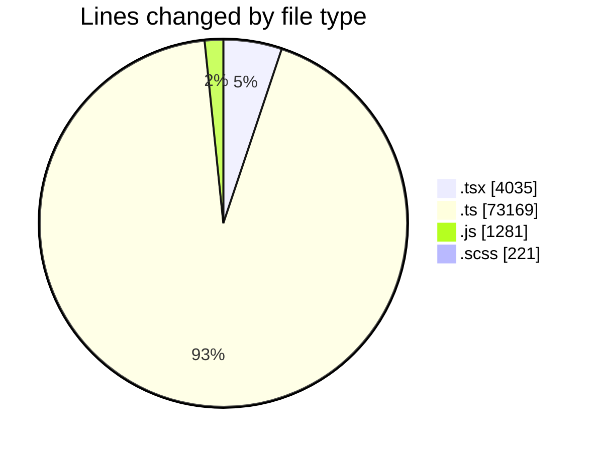
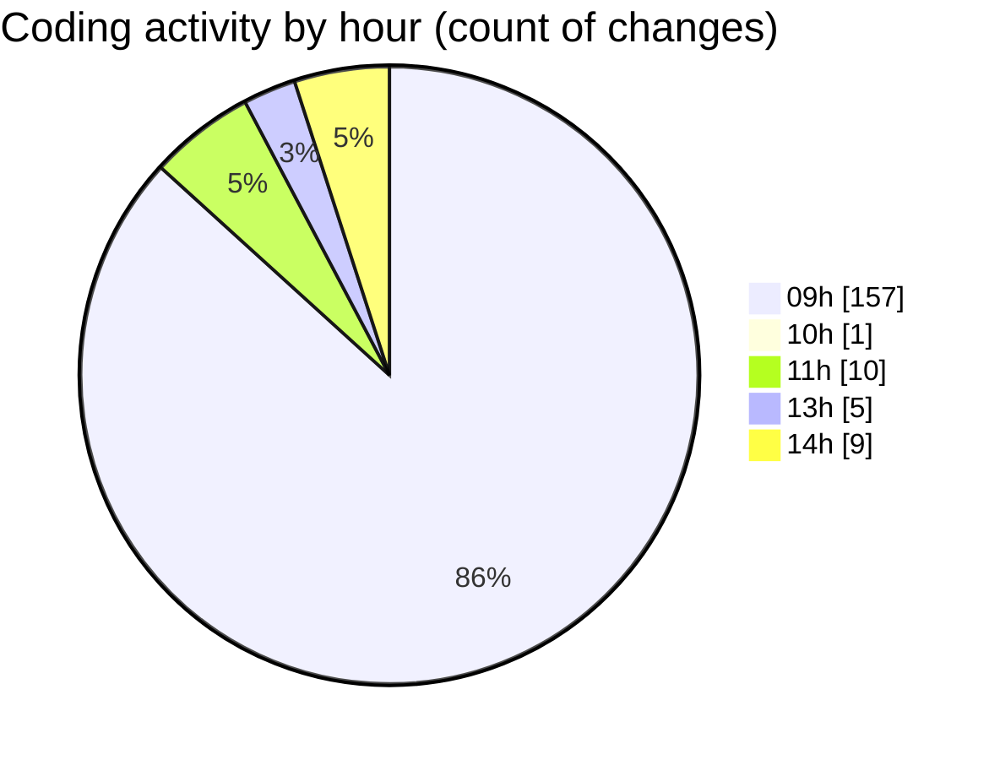

# cda - Activity Summary 

## Overall Statistics

| Stat                   | Value                                                             |
| ---------------------- | ----------------------------------------------------------------- |
| **Lines Added** (➕)   | 75208                                          |
| **Lines Removed** (➖) | 3498                                        |
| **Net Change** (↕)    | 71710                |
| **Active Time** (⌚)   | 194 minutes |

## Modified Files
- **NewAlert.tsx** (+592, -221)
- **system.ts** (+1094, -558)
- **approvedUrl.test.ts** (+48, -4)
- **approvedUrl.ts** (+50, -0)
- **RouteWrapper.tsx** (+234, -22)
- **AlertService.ts** (+849, -57)
- **AuditService.ts** (+422, -16)
- **yesalert.ts** (+1018, -69)
- **yesalert.js** (+1208, -73)
- **MockStaffStatusService.ts** (+96, -1)
- **SystemService.ts** (+376, -106)
- **policies.ts** (+36, -8)
- **MockSystemService.ts** (+192, -31)
- **StaffStatusService.test.ts** (+1116, -206)
- **alertTransformer.ts** (+82, -1)
- **YesAlertService.ts** (+240, -20)
- **AlertService.test.ts** (+2743, -593)
- **yesalert-mutations.ts** (+1406, -32)
- **resolvers-types.ts** (+18093, -273)
- **views.ts** (+12067, -609)
- **tables.ts** (+8887, -548)
- **sap_views.ts** (+1913, -22)
- **ApprovedUrlModal.tsx** (+233, -24)
- **ConfigApprovedDomains.tsx** (+377, -4)
- **NewTemplate.tsx** (+339, -0)
- **gql.ts** (+496, -0)
- **CohortDetail.test.tsx** (+239, -0)
- **App.tsx** (+298, -0)
- **graphql.ts** (+10823, -0)
- **CohortDetail.tsx** (+135, -0)
- **Home.test.tsx** (+261, -0)
- **graphql.ts** (+7899, -0)
- **cohorts.ts** (+69, -0)
- **CohortGroups.test.tsx** (+349, -0)
- **CohortGroups.tsx** (+136, -0)
- **ApprovedUrlModal.test.tsx** (+395, -0)
- **ApprovedUrlForm.tsx** (+84, -0)
- **ApprovedUrlForm.test.tsx** (+92, -0)
- **EmailVisualisation.scss** (+221, -0)

## Visualizations

### By File Type (Lines Changed)

### By Hour (Estimated Activity Count)

> **Last Updated:** 09/11/2026, 14:26:29