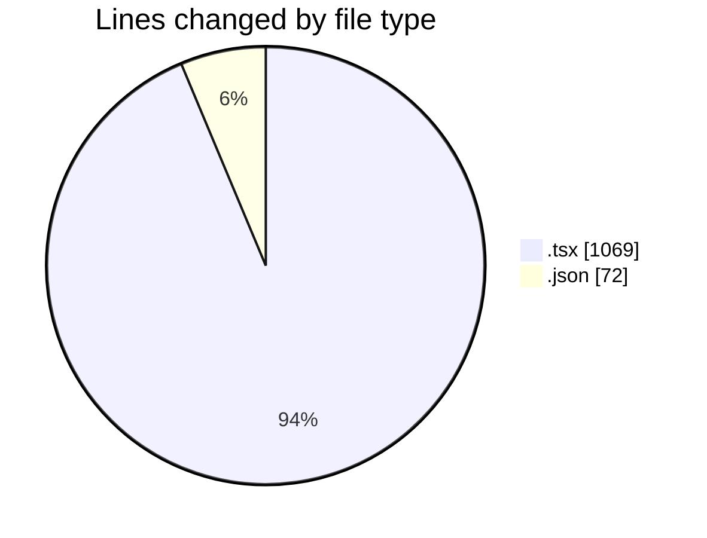
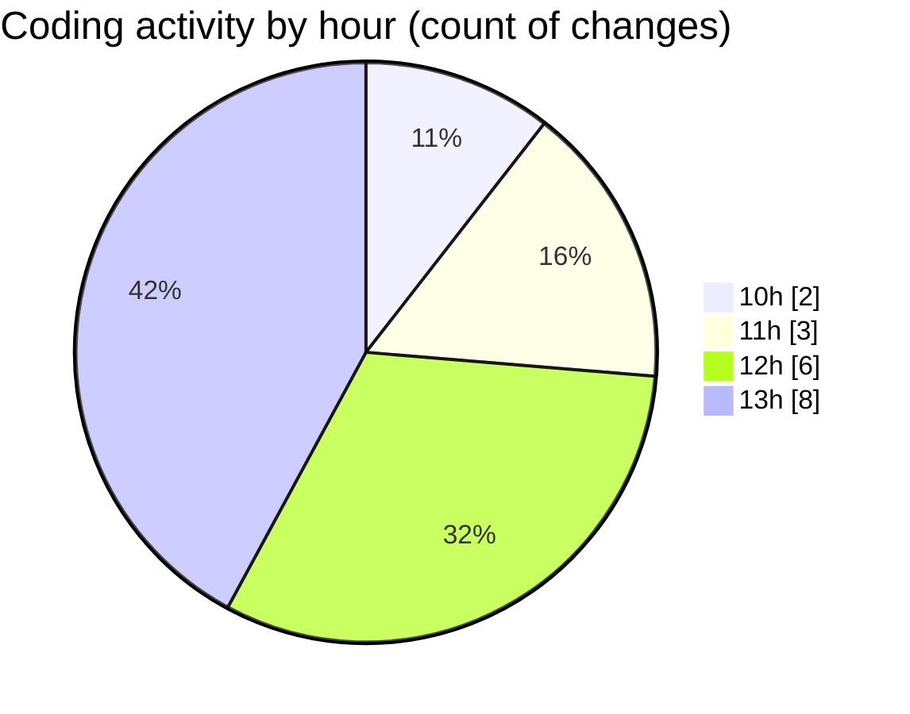

# cda - Activity Summary 

## Overall Statistics

| Stat                   | Value                                                             |
| ---------------------- | ----------------------------------------------------------------- |
| **Lines Added** (➕)   | 1125                                          |
| **Lines Removed** (➖) | 16                                        |
| **Net Change** (↕)    | 1109                |
| **Active Time** (⌚)   | 20 minutes |

## Modified Files
- **App.tsx** (+298, -0)
- **AlertedStaff.tsx** (+460, -10)
- **AlertedStaff.test.tsx** (+229, -6)
- **SafePeople.tsx** (+66, -0)
- **package.json** (+72, -0)

## Visualizations

### By File Type (Lines Changed)

### By Hour (Estimated Activity Count)

> **Last Updated:** 11/11/2026, 13:34:20