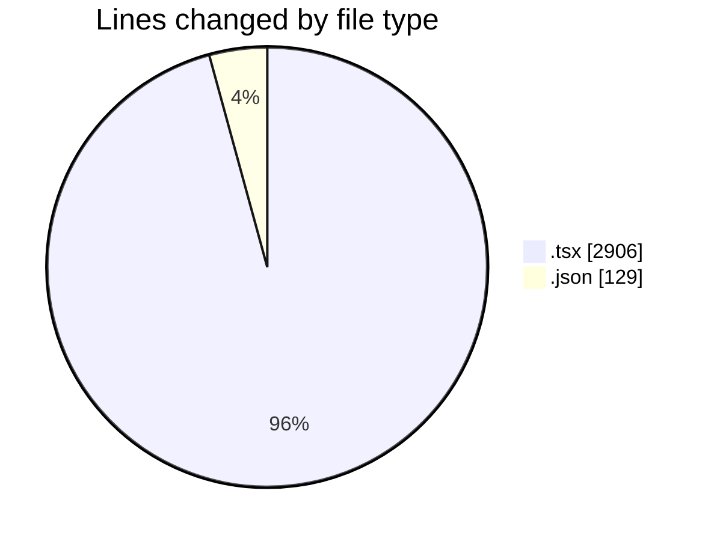
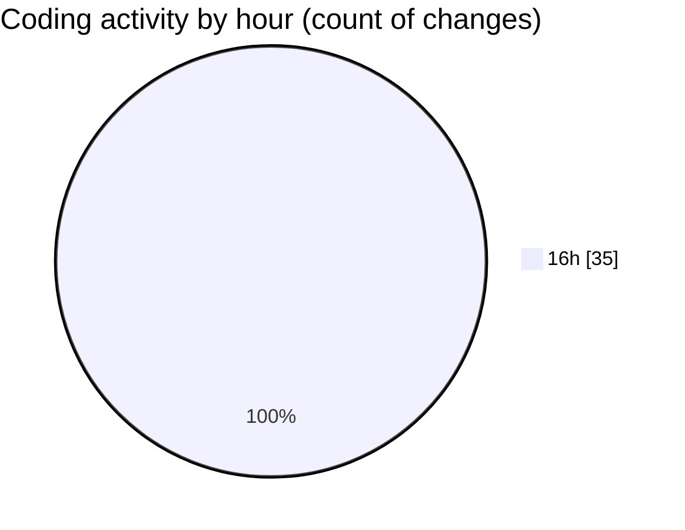

# broadcaster-v6-feature - Activity Summary 

## Overall Statistics

| Stat                   | Value                                                             |
| ---------------------- | ----------------------------------------------------------------- |
| **Lines Added** (➕)   | 2999                                          |
| **Lines Removed** (➖) | 36                                        |
| **Net Change** (↕)    | 2963                |
| **Active Time** (⌚)   | 44 minutes |

## Modified Files
- **OnAir.tsx** (+127, -1)
- **OnAirView.tsx** (+163, -2)
- **chatLanguageModels.json** (+24, -0)
- **settings.json** (+105, -0)
- **OnAirPublicSource.tsx** (+35, -1)
- **PrivateTransportControls.test.tsx** (+1976, -0)
- **OnAirAccessibility.test.tsx** (+114, -0)
- **OnAirLiveStreamCard.tsx** (+53, -0)
- **OnAirNowPlayingCard.tsx** (+402, -32)

## Visualizations

### By File Type (Lines Changed)

### By Hour (Estimated Activity Count)

> **Last Updated:** 13/11/2026, 16:27:05