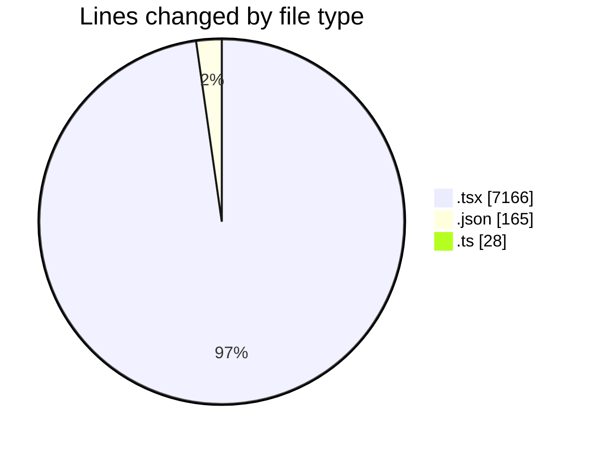
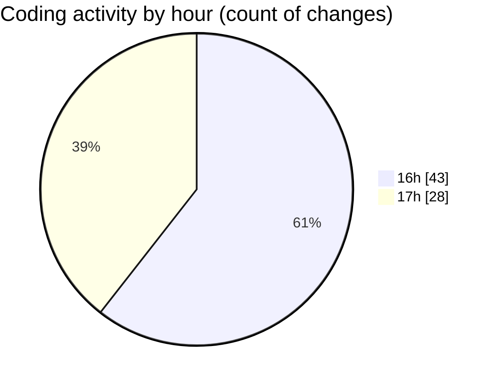

# broadcaster-v6-feature - Activity Summary 

## Overall Statistics

| Stat                   | Value                                                             |
| ---------------------- | ----------------------------------------------------------------- |
| **Lines Added** (➕)   | 7263                                          |
| **Lines Removed** (➖) | 96                                        |
| **Net Change** (↕)    | 7167                |
| **Active Time** (⌚)   | 94 minutes |

## Modified Files
- **OnAir.tsx** (+128, -50)
- **OnAirView.tsx** (+163, -2)
- **chatLanguageModels.json** (+24, -0)
- **settings.json** (+137, -0)
- **OnAirPublicSource.tsx** (+35, -1)
- **PrivateTransportControls.test.tsx** (+1976, -0)
- **OnAirAccessibility.test.tsx** (+114, -0)
- **OnAirLiveStreamCard.tsx** (+53, -0)
- **OnAirNowPlayingCard.tsx** (+402, -32)
- **OnAirHeader.test.tsx** (+23, -0)
- **OnAirPublicSource.test.tsx** (+26, -0)
- **OnAirViewerStatsStrip.test.tsx** (+25, -0)
- **OnAirLiveStreamCard.test.tsx** (+36, -0)
- **TransportButtons.test.tsx** (+34, -0)
- **OnAir.test.tsx** (+1800, -0)
- **App.tsx** (+130, -3)
- **OnAirPrivateTransportControls.test.tsx** (+1993, -0)
- **TransportButtons.tsx** (+136, -4)
- **vitest.config.ts** (+24, -4)
- **settings.json** (+4, -0)

## Visualizations

### By File Type (Lines Changed)

### By Hour (Estimated Activity Count)

> **Last Updated:** 13/11/2026, 17:37:05