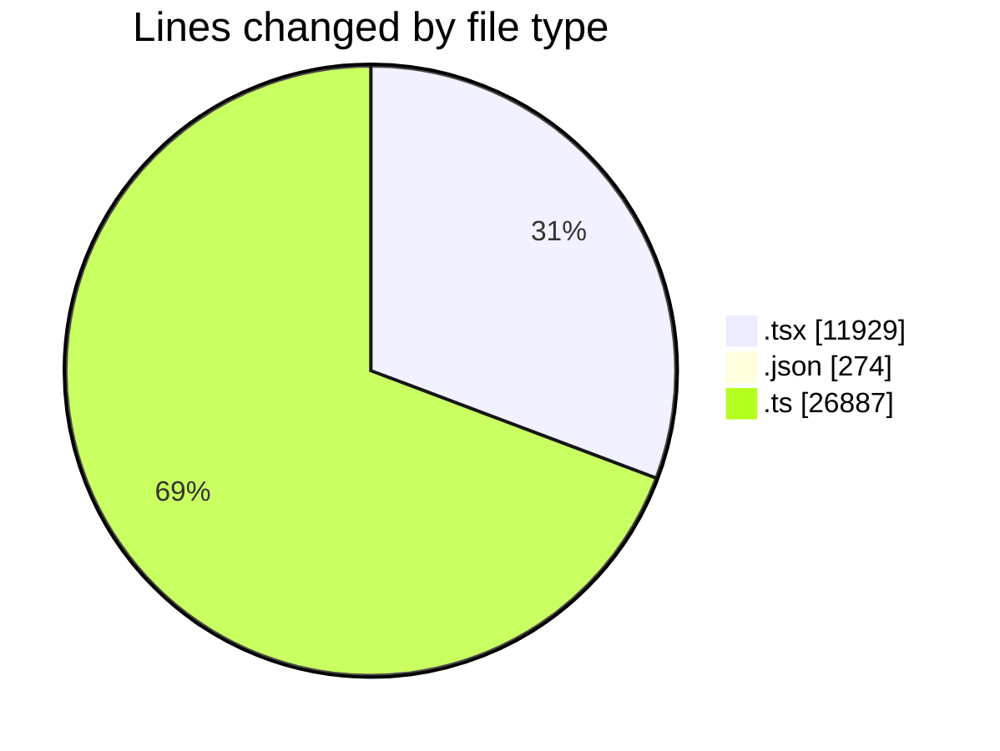
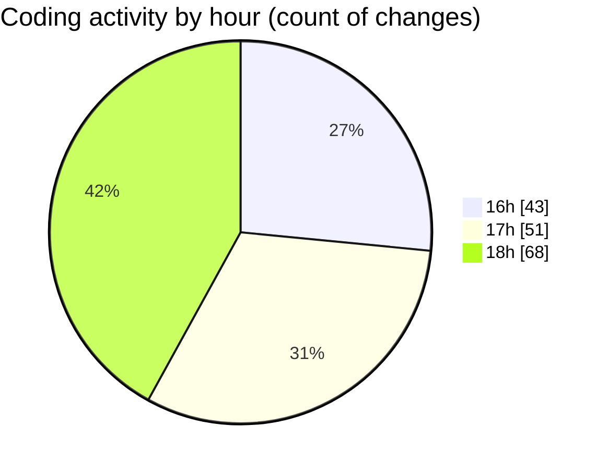

# broadcaster-v6-feature - Activity Summary 

## Overall Statistics

| Stat                   | Value                                                             |
| ---------------------- | ----------------------------------------------------------------- |
| **Lines Added** (➕)   | 38861                                          |
| **Lines Removed** (➖) | 229                                        |
| **Net Change** (↕)    | 38632                |
| **Active Time** (⌚)   | 220 minutes |

## Modified Files
- **OnAir.tsx** (+128, -51)
- **OnAirView.tsx** (+163, -2)
- **chatLanguageModels.json** (+24, -0)
- **settings.json** (+148, -1)
- **OnAirPublicSource.tsx** (+35, -1)
- **PrivateTransportControls.test.tsx** (+1976, -0)
- **OnAirAccessibility.test.tsx** (+114, -0)
- **OnAirLiveStreamCard.tsx** (+53, -0)
- **OnAirNowPlayingCard.tsx** (+402, -32)
- **OnAirHeader.test.tsx** (+23, -0)
- **OnAirPublicSource.test.tsx** (+26, -0)
- **OnAirViewerStatsStrip.test.tsx** (+25, -0)
- **OnAirLiveStreamCard.test.tsx** (+36, -0)
- **TransportButtons.test.tsx** (+34, -0)
- **OnAir.test.tsx** (+1817, -0)
- **App.tsx** (+142, -75)
- **OnAirPrivateTransportControls.test.tsx** (+1993, -0)
- **TransportButtons.tsx** (+136, -4)
- **vitest.config.ts** (+37, -14)
- **settings.json** (+4, -0)
- **UserProvider.tsx** (+208, -0)
- **Navigation.tsx** (+98, -1)
- **Navigation.test.tsx** (+90, -0)
- **UserProvider.test.tsx** (+141, -0)
- **tsconfig.json** (+35, -10)
- **LoginPage.tsx** (+85, -7)
- **LoginPage.test.tsx** (+58, -0)
- **index.tsx** (+1, -0)
- **index.ts** (+3, -0)
- **setup.ts** (+4, -2)
- **lucide-react.d.ts** (+26572, -0)
- **Navigation.test.tsx** (+91, -1)
- **LoginPage.test.tsx** (+58, -0)
- **package.json** (+52, -0)
- **PlayoutLayout.tsx** (+32, -3)
- **LogoBrand.tsx** (+12, -1)
- **TimeDisplay.tsx** (+47, -8)
- **setupTests.ts** (+8, -0)
- **vite.config.ts** (+23, -5)
- **OnAirPrivateTransportControls.tsx** (+1073, -0)
- **TransportReadout.tsx** (+224, -0)
- **OnAirPrivateTransportControls.test.tsx** (+1993, -0)
- **OnAirHeader.tsx** (+62, -5)
- **OnAirRunningOrderList.tsx** (+238, -6)
- **timeZone.ts** (+219, -0)
- **OnAirHeader.test.tsx** (+26, -0)
- **OnAirLiveStreamCard.test.tsx** (+37, -0)
- **OnAirLiveStreamCard.tsx** (+55, -0)

## Visualizations

### By File Type (Lines Changed)

### By Hour (Estimated Activity Count)

> **Last Updated:** 13/11/2026, 18:57:05